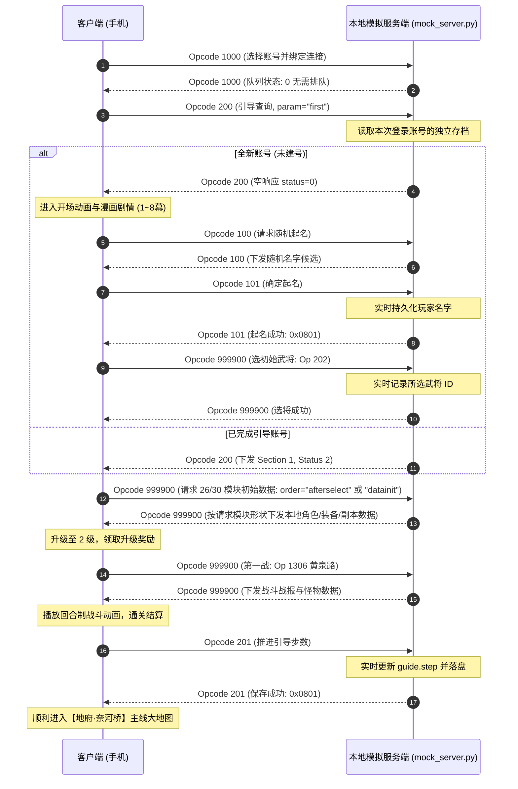

# 《作妖计》(ZuoYaoJi) 本地单机模拟服与逆向工程套件

本仓库提供《作妖计》(Cocos2d-x + Lua + Protobuf 架构) 手游的完整本地单机化运行环境、离线模拟服务端、逆向分析资源以及自动化重打包脚本。

---

## 🌟 核心特性

- **局域网直连，无需 ADB**: 安卓手机与电脑模拟器使用同一份 APK，直接连接电脑的固定局域网 IP 和统一端口 `14600`；不依赖 USB 调试或 `adb reverse`。
- **多账号独立存档**: 复用登录页选服界面选择“账号 1、账号 2 …”，每台设备记住自己的选择。一个服务端同时处理不同账号；同一个账号只允许一个在线连接，避免覆盖进度。这是独立存档多开，不提供账号间交易、组队等共享世界功能。
- **本机 GM 工作台**: 总览、玩家筛选与分栏档案；离线调整资源、发放道具/碎片/普通装备/招募池武将；操作流水、备份恢复及配置原始值对比。
- **全流程新手引导支持**: 完整保留原汁原味的游戏体验，包括开场剧情漫画（1~8幕）、起名与随机名字生成、3选1初始武将、新手第一战（黄泉路对阵小野鬼回合制战斗）、升级结算与主线地府大地图。
- **自研战斗 v2**: 招募武将可自由上阵，按同一引擎实时挑战全部普通主线（62章、310图、3061关），包含治疗、增减益、突破、魔罩、真实胜负、掉落与升级，以及三星后的单次/批量扫荡；采用的自研规则见 [battle_rules.md](battle_rules.md)。
- **本地模拟充值与封神招募**: 点击充值档位直接确认本地支付成功，按配置发元宝、VIP及首充/月卡权益；封神支持单抽、十连预览、重抽和确认领取，未领取结果重登保留。
- **渐进式角色持久化存档 (`role_save.json`)**:
  - 实时捕获并记录玩家自定义起名（Opcode 101）；
  - 实时记录玩家所选初始武将（Opcode 202）；
  - 实时记录新手引导与剧情步数（Opcode 201 `guide.step`）；
  - 支持中途退出后的**断点无缝续存**；
  - 账号 1 沿用 `role_save.json`，其他账号使用 `accounts/<编号>/role_save.json`；可按账号重置，引导与角色快照互不影响。
- **Comb Signature 复合路由**: 客户端 `Opcode 999900` (`CombMessages`) 按子消息 ID 集合与完整请求载荷匹配，兼容 Comb 封装、引导 `201` 及上阵 `1003` 的 Protobuf 字段顺序差异，区分主城 26/30 模块、功能列表和不同关卡；录制段之间隔离应答序号，避免混合采集后重复回包。
- **TCP 流重组还原 (TCP Stream Reassembly)**: 彻底修复抓包中超过单帧 MTU 限制的分包数据（4,101 字节全量主城包），根除 Protobuf 反序列化时触发的 `decoder:247 Truncated message` 致命错误。
- **全量离线配置内置**: 将从官方 CDN 提取的 1,244+ 个 JSON 数据表注入 APK assets 中，彻底解决离线时缺少 `guide_step.json` / `guide_section.json` 导致的黑屏崩溃。
- **自动化秒级打包流水线**: `build_local_apk.py` 使用 Python 原生 zip 操作与 `apksigner`，绕过容易出现资源解析崩溃的 Apktool 回编译，数秒内完成改包与 V1/V2 签名。

---

## 📂 项目结构全景

```text
zyj/
├── mock_server.py           # 启动入口、命令行、局域网 TCP 与账号绑定
├── zyj_server/              # 模拟服请求处理，不依赖启动入口
│   ├── protocol.py          # TCP 封包、Protobuf 与 Comb 编解码
│   ├── guide.py             # 引导配置、进度、迁移与消息
│   ├── accounts.py          # 账号占用、独立路径与离线维护锁
│   ├── configuration.py     # 配置校验、覆盖与服务端/APK 共用读取
│   ├── storage.py           # 原子文件写入与备份
│   ├── diagnostics.py       # 空回复、原生错误与连接异常的滚动诊断日志
│   ├── admin/               # HTTP 路由、存档视图与独立 HTML/CSS/JS
│   ├── activities.py        # 活动页面、首期珍品限购、消费奖励及提示
│   ├── daily_events.py      # 首期累计/双倍充值、月周基金及加速礼包
│   ├── online_rewards.py    # 每日在线计时、四档奖励及领取状态
│   ├── shop.py              # 商城道具、VIP/周礼包购买与固定礼包开启
│   ├── resource_purchase.py # 体力/精力购买、报价与每日次数
│   ├── qiankun.py           # 乾坤炉炼化、实际消耗收据与安全重生
│   ├── secret_shop.py       # 神魂商店货架、购买与刷新
│   ├── fashion.py           # 主角时装拥有、穿戴、隐藏与强化
│   ├── battle.py            # 确定性自动战斗、目标/技能/状态、伤害与成长计算
│   ├── recruit.py           # 普通/封神招募、暂存预览、武将去重
│   ├── recharge.py          # 本地模拟订单、VIP及首充/月卡权益
│   ├── formation.py         # 换将/布阵、装备继承、缘分属性差量
│   ├── player.py            # 角色/主角状态、存档与整组回包准备
│   ├── replay.py            # 共享录制索引、每连接的匹配计数
│   └── session.py           # Session.handle() 请求处理入口
├── build_local_apk.py       # 自动化 APK 本地化注入、热更与打包签名脚本
├── recorded_frames.json     # 经过 TCP 流重组还原的 529 条真实业务协议帧库
├── test_activity_frames.json # 完成账号抓包的活动查询/奖励测试样本，不作为玩家初始状态
├── battle_rules.md          # 自研 v2 范围、公式、结算规则与试玩说明
├── role_save.json           # 账号 1 的原有存档，不自动搬迁
├── accounts/2/role_save.json# 账号 2 的独立存档 (其他账号同理，运行时生成)
├── config_overrides.json    # 网页保存的少量配置覆盖 (运行时生成，Git 忽略)
├── backups/                 # 账号及配置的历史备份 (运行时生成，Git 忽略)
├── logs/diagnostics.log      # 专用 JSON 行诊断日志 (运行时生成，Git 忽略)
├── test_mock_server.py      # 协议、玩法状态、账号隔离与双连接回归
├── test_build_local_apk.py  # 局域网配置和客户端补丁回归
├── test_admin.py            # 离线维护、配置一致性与 HTTP 回归
├── debug.keystore           # 统一签名密钥库
├── configs_sec5.zip         # 官方全量 1,244+ 个离线 JSON 配置文件
├── scripts_clean/           # 解密且纯净格式化的 1,300+ 个 Lua 脚本源码 (便于审计分析)
├── scripts_decrypted/       # 解密出的原版 Lua 脚本资产
├── zyj_tutorial_traffic.pcap# 抓取自官方新手教程的原始 TCP 通信流量
├── z7_7_4.apk               # 官方原始 APK
├── zyj_local.apk            # 注入离线配置与局域网直连的客户端
└── README.md                # 本说明文档
```

`Session.handle(opcode, seq, body)` 返回有序的完整协议帧，不持有 socket；录制回包统一经过 `player.prepare_recorded_responses()`，原子保存成功后才返回给 TCP 入口发送。请求处理抛错后入口关闭连接，不继续使用该会话。配置、录制和默认存档路径由根目录入口确定并显式传入，导入 module 不读取资源或启动 ADB/监听。

---

## 🛠️ 网络协议与封包规范

### 1. 基础包头结构 (16 字节)
通信基于 TCP 二进制协议，每个数据包均包含 16 字节固定大端包头：

| 偏移 | 字段名 | 类型 | 字节序 | 描述 |
| :--- | :--- | :--- | :--- | :--- |
| `0x00` | Magic | `uint32` | Big-Endian | 协议魔数，固定为 `0x0000EE1C` |
| `0x04` | Length | `uint32` | Big-Endian | 后续载荷 (Payload) 字节长度 |
| `0x08` | Opcode | `uint32` | Big-Endian | 协议操作码 (例如 `1000` 登录, `200` 引导) |
| `0x0C` | Seq | `uint32` | Big-Endian | 请求序号 (客户端发起递增，服务端原样应答) |

### 2. 核心协议交互流程


---

## 🚀 快速上手

### 1. 环境准备
- 操作系统: Linux / macOS / Windows (WSL)
- Python 3.8+
- 安卓手机或安卓模拟器，能访问服务端电脑所在的可信局域网或虚拟组网；无需开启 USB 调试
- 仅重打包时需要：原版 `z7_7_4.apk`、Java Runtime 和 Android SDK build-tools (`zipalign`、`apksigner`)
- 建议在路由器为服务端电脑保留固定 IP；电脑防火墙只对可信局域网放行 TCP `14600`，不要设置公网端口转发

### 2. 构建一次局域网客户端

默认使用 `10.66.0.x` 虚拟组网，电脑和手机均需保持组网连接：

- 游戏服务端：电脑 **`10.66.0.12:14600`**。
- 无线调试：手机 **`10.66.0.50:5555`**（`NOH-AN00`）。

2026-10-29 已从手机连续三次直连该游戏端口并收到预期协议回包（61–87 ms），同时验证无线 ADB 可执行命令；期间一次组网短暂掉线，恢复后复测通过。地址重新分配后需重新确认。

把原版 `z7_7_4.apk` 放在脚本旁，指定**服务端电脑**的 IP：

```bash
python3 build_local_apk.py --server-ip 10.66.0.12 --accounts 3
```

`--server-ip` 必填，只接受局域网 IPv4，拒绝回环地址和公网地址；`--accounts` 默认为 2，范围 1~1000，只控制登录页的预设账号列表。登录表单可输入任意 1~1000 的已启用账号，后台新增账号无需重打包。所有账号共用同一个 IP 和端口；电脑 IP 改变后需要重新打包、更新客户端。

### 3. 启动统一服务端
```bash
# 监听 0.0.0.0:14600，不调用 ADB
python3 mock_server.py
```
保持服务端运行，再进入游戏。能播放本地开场剧情并不表示已连上游戏服务；服务未启动时，随机取名和建号请求无法正常完成。

在运行服务端的电脑上打开 **http://127.0.0.1:14601** 进入管理后台。后台与游戏共用一个进程和账号占用表，随服务端退出而关闭。端口冲突时可用 `--admin-port 14602`；指定 `0` 会自动分配端口，以启动日志中的地址为准。

#### 空回复与错误诊断

服务启动后自动写入仓库内 **`logs/diagnostics.log`**，每行一条 JSON，实时追加；每份约5 MiB，保留当前文件及 `.1`～`.3` 三份旧日志。启用此功能只需重启服务端。

- `error_response`：原生 `999999` 拒绝，附错误码和 `1999` 中文原因；`exception`：登录、请求处理、保存或发送异常，附阶段及调用栈。
- `empty_response`：零字节回包和 Comb 内的空子包，仅记为 **INFO**，不代表失败；正常空心跳 `999904` 略过。`no_response` 表示处理结果没有任何回复，`invalid_response` 表示诊断发现回包格式异常。
- 记录 UTC 时间、账号、客户端地址、请求 opcode/seq、请求 hex/可直接识别的 Ids 参数及响应长度。单个请求体最多记录4096字节，超长标记 `truncated`；Comb 列出子请求，保留顺序。登录、未认证请求和支付凭证不记录内容；含登录/嵌套 Comb 或无法解析的 Comb 整体脱敏。
- `phase=response` 是已发送的响应组；`phase=handle/send/login/receive` 的异常记录用于定位发生阶段，其中 `responses` 可能只是已准备的回包。日志失败只提示，不阻断游戏或改变保存结果；存档失败仍按原逻辑断开连接。

复现问题后，提供发生时间、账号、页面/按钮，以及当前日志和同期轮转文件即可。实时查看：

```bash
tail -f logs/diagnostics.log
```

五项充值活动的历史排查和客户端字段依据见 [活动补录清单](activity_capture_20261029.md)；当前实现范围以本文“日常活动充值页签”为准。

2026-10-29 诊断日志验证：**275项回归**、Python/管理页语法检查通过，覆盖登录脱敏、空包/无回包区分、Comb空子包、保存/发送异常及日志写入失败不影响游戏。服务已重启，手机重连后实际记录到 `999989`、`1055 [1,10]/[1,1]` 拒绝，以及 Comb 中 `4800/6911` 的空回复。重启前后角色、背包、阵容、关卡、引导及充值/招募/活动状态一致，仅正常更新登录时间和体力时钟；日志未见密码原文。未重新验证这些未实现活动的购买/领奖。

> [!WARNING]
> 账号需在后台设置密码才能登录，包括原有账号。密码采用加盐 PBKDF2-SHA256 存储，但游戏 TCP 链路仍未加密，仅用于可信局域网，不可直接开放到公网。电脑关机、休眠或网络断开都会影响游玩。

### 4. 创建账号并登录

先在管理后台打开一个 1~1000 的账号编号，输入并确认密码，点击“创建登录账号”；原有存档点击“绑定密码，保留进度”。密码为 8~64 位英文字母、数字或符号，不含空格。账号编号就是登录名，没有默认密码、游客绕过或客户端自由注册。

把同一份新版 `zyj_local.apk` 传到手机、导入模拟器安装，点击图标启动。首次在原生表单输入账号编号和密码；服务端认证成功后记住这一组凭据，下次启动等待2秒自动进入，可点击“切换账号”取消并打开表单。认证拒绝会清除记住的密码；连接失败保留凭据，停止本轮自动尝试，确认提示后回表单重试。手机、模拟器使用不同账号可同时游玩；换设备时输入原账号密码续玩，需先退出原设备。自用局域网版通过 `CCUserDefault` 明文保存凭据，密码框保持掩码且不打印输入内容。

服务端验证密码后才占用账号并读取存档。旧版仅发送账号编号的客户端会被拒绝，必须重新构建并安装 APK。同一账号一分钟内连续失败五次后暂停登录一分钟，其他账号不受影响。当前版本不提供密码修改或找回，请妥善保管密码。

ADB 可以仅用于可选的安装和日志调试，游戏连接不经过它：

```bash
adb connect 10.66.0.50:5555
adb -s 10.66.0.50:5555 install -r zyj_local.apk
adb -s 10.66.0.50:5555 shell monkey -p com.ldfs.zyjyg.local -c android.intent.category.LAUNCHER 1
```

若无法连接，检查 IP 是否正确、防火墙是否允许该端口、Wi-Fi 是否启用了访客隔离或客户端隔离。异常断网后旧会话需等待 TCP 断开才能释放；首版不自动踢旧会话接管。

### 5. 按账号重置

也可从命令行重置：先停止正在运行的服务端，再执行以下命令。操作前自动备份目标存档，重置后仍会启动统一服务端：

```bash
python3 mock_server.py --account 2 --reset
python3 mock_server.py --account 2 --reset-guide
```

两条命令分别表示清空账号 2 的全部进度、仅清空账号 2 的引导。未指定 `--account` 时仍以账号 1 为目标，不影响其他账号。所有存档相对脚本目录；在新 worktree 或复制工程中启动时，不会自动读取旧目录的存档，迁移前请停服并备份。

### 6. GM 工作台、账号维护与配置编辑

**工作台总览**展示账号、在线玩家、已建角色、档案异常数及配置版本和最近操作。**玩家管理**列出已设置密码、已存档、在线或有备份的账号，支持账号/角色名搜索、在线状态与最低等级筛选、每页 25 条；输入 1～1000 的编号即可打开或创建。玩家档案通过页签展示角色资源、武将阵容、装备背包、副本与引导、模拟充值/月卡、活动领取和招募冷却。副本宝箱区分未达标、可领取与已领取。点击“刷新数据”更新；查询不会触发体力恢复或修改存档，在线数值以游戏最后一次成功保存为准。

**GM 调整与发放**先读取离线玩家，再填写资源增减量、选择物品并填写原因。支持元宝、银币、体力、精力的非零整数增减，最终余额必须在 0～2147483647 内；GM 元宝修正不增加消费活动进度或充值/VIP权益。体力在提交时按同一时间结算离线恢复，允许合法超上限。物品目录按运行中的配置搜索名称/ID，支持道具、有效武将碎片、普通四类装备，以及现有招募池的基础武将；重复武将按现有招募规则转碎片，发武将需先完成新手引导。最多 32 种物品，每种道具/碎片最多 1000000，装备与武将合计最多 100 个。入库不代表道具使用功能已实现。

**背包管理**在玩家档案的“背包”页签中按名称、配置 ID 或道具/碎片类型筛选，点击“调整数量”填写目标总量（0～2147483647），可用增减按钮或“清空”。修正数量只改库存，不触发道具使用、碎片合成或奖励效果。碎片页显示可发放的碎片道具 ID，内部转换为存档中的武将 ID。GM 发放页提供体力丹、精力丹、三类招募令和四类经验丹的快捷入口，点击后加入发放清单，再填写数量与原因。

**英雄管理**在“武将与装备”页签筛选已上阵、闲置、助阵武将，展开名称可查看配置/实例 ID、品质、经验、潜力和战斗属性。完成新手引导后可离线执行：

- **升级**：填写高于当前等级且不超过角色等级限制的目标等级，不消耗经验丹；复用游戏成长计算，同步属性、潜力、主角快照和阵容战力，保留培养加成。助阵或尚未支持的高级属性武将拒绝修改。
- **上阵 / 下阵**：选择已解锁阵位或下阵；替换闲置武将继承阵位装备，移动已上阵武将交换整套阵位与装备，按当前成员重算缘分差值；主角必须留在阵中。
- **移除**：仅移除非主角的闲置武将及其培养进度，不返还材料或碎片；上阵、助阵武将须先处理阵位。需要撤销时恢复该次操作前的备份。

上述操作统一经 `Workbench.apply(account, data)`，使用相同的离线锁、版本检查、备份、操作回执与流水。原发放请求保持兼容；管理请求带 `action`：`inventory`（`cid`、目标 `count`）、`general-level`（`iid`、目标 `level`）、`formation`（`iid`、目标 `position`，0 表示下阵）或 `remove-general`（`iid`），以及通用的 `operation_id`、`revision`、`reason`。同一请求只执行一个管理动作。页面在请求结果未确认时保留原编号，并提供查询/重试入口。

每次 GM 操作校验离线状态与存档版本，在副本上准备全部变更，先备份，再通过游戏的统一保存入口同步资源、背包、角色快照和体力时钟；重登后生效。请求使用唯一操作编号，同编号同参数重试只返回原结果。页面在会话存储中保留未确认请求，刷新后可按原编号查询/重试。`gm_operations/<操作ID>.json` 保存意图和结果，`gm_receipt` 随存档原子写入，发放已保存但最终日志写失败时可据此确认成功；无法确认的中断操作显示“待核对”，不会自动重新执行。

**操作记录**可按账号、类型和日期筛选，查看 GM 实际变更、前后版本、结果与备份编号；同时记录网页创建账号、备份、恢复、重置和配置修改。流水独立于游戏存档，恢复旧存档不会删除记录或让已成功的请求重复发放；不记录密码、盐或哈希。迁移工程时一并保留 `gm_operations/`，该目录不提交 Git。当前操作者统一为本机管理员，记录从启用此版本后开始。

登录凭据独立保存在 `accounts/<编号>/credentials.json`，使用随机盐和 600000 次 PBKDF2-SHA256，原子落盘；后台响应不包含密码、盐或哈希。设置密码立即生效，不创建或改写游戏存档。已有凭据禁止覆盖，在线账号禁止绑定。进度重置、恢复、下载均不包含或改动凭据；迁移工程时需同时保留凭据文件和存档（均不提交 Git）。

退出目标账号的游戏连接后，可创建备份、重置引导、重置账号或选择备份恢复；其他账号可继续游玩。登录与维护共用锁，在线账号拒绝维护。操作核对存档版本，页面过期时刷新重试。重置和恢复会先把当前文件备份到 `backups/accounts/<编号>/<备份ID>.json`；备份失败则停止操作。恢复前通过游戏存档校验，保存失败保留原文件。重置后仍可从账号列表找到备份并恢复。“下载存档”只导出当前文件，也可用于保留损坏文件。

重置引导只清除引导历史，保留角色、背包与奖励领取记录，不会重新发奖；完整新号体验使用“重置账号”。

**游戏配置**支持分类、配置表、ID或文本浏览，展开条目可比较原始值与本地覆盖，编辑弹窗显示中文字段和原始值；当前只允许编辑：

| 表 | 条目 | 可编辑内容 |
| --- | --- | --- |
| `props` | 20014 / 20019 / 20015 / 20020 | 恢复量、道具说明 |
| `begin7day_task` | 80001 / 80030 | 首日奖励、名称 |
| `liveness` | 16（协议任务 116） | 强化次数门槛、奖励及说明 |

奖励格式为 `物品ID,数量;`，只接受已实现的银币、元宝、道具、碎片和装备；未知物品、重复条目及越界数量会被拒绝。保存只写 `config_overrides.json`，原 ZIP 保留，旧覆盖备份到 `backups/configs/`；“恢复原配置”移除该条目的覆盖。

配置修改对所有账号生效，已有领取记录不会清除。**保存后需停止并重启服务端，再重建、安装 APK**：服务端和打包器读取同一份覆盖，APK 的 `assets/config/1/` 与 `assets/config/5/` 同步更新。运行中的会话继续使用启动时配置；网页显示“等待服务端重启”直到当前覆盖被加载。恢复量或奖励改变时，也应修改对应说明文字。

后台固定绑定 `127.0.0.1`，校验 Host/Origin 和本次进程的写入令牌；使用浏览器直接打开日志中的本机地址。

---

## 🔨 重新构建本地化客户端 (`build_local_apk.py`)

将原版 APK 放到脚本旁并命名为 `z7_7_4.apk`，安装 Android SDK build-tools 并设置 `ANDROID_HOME`（或把 `zipalign`、`apksigner` 加入 PATH），即可构建 `zyj_local.apk`：

```bash
python3 build_local_apk.py --server-ip 10.66.0.12 --accounts 3
```

构建器从原 APK 解密脚本，在 `get_patched_lua_scripts()` 中执行带版本断言的替换；`scripts_clean/` 仅供分析，直接修改它不会打入 APK。工具查找兼容 Windows 的 `.exe/.bat` 和 macOS/Linux 的无后缀工具名。

该脚本将自动执行：
1. **注入离线全量 JSON 配置**: 读取 `configs_sec5.zip` 与 `config_overrides.json`（若存在），注入 APK 的 `assets/config/1/` 和 `assets/config/5/`，保留引导热区补丁；
2. **统一局域网入口**: 生成预设账号列表，全部连接指定电脑 IP 的 `14600` 端口；复用原生账号密码表单，登录消息携带账号标识和密码，账号编号不改变离线配置的 section；
3. **解除日志打印抑制**: 启用底层 `log.so` 日志透传，允许 Lua 输出和报错直达 `adb logcat`；
4. **V1 + V2 签名生成**: 使用 `debug.keystore` 自动签名，生成即装即用的 `zyj_local.apk`。

充值页补丁由 `patch_recharge_script()` 生成，使用普通 `CCScrollView` 承载八个档位，避开崩溃栈中的 `LuaEventHandler::tableCellAtIndex` 路径。`UIRecharge` 收到 `115` 订单后直接发送 `116` 确认，不调用支付SDK；无需支付凭证 `20000`。`window_recruit` 恢复封神令不足时的元宝显示及支付分支，连续单抽会刷新下次支付类型。这轮功能需要重新构建并安装 APK。

充值后曾因月卡回调预加载未实现活动 `3680`，触发错误码0的默认主城刷新，再次查询 `2039` 和活动Comb，造成“无效请求”循环。打包补丁现在将 `logError.errorFunc[0]` 接到已有的只提示处理，仍通过 `9999` 正常解除等待；其他错误处理保留。`UIMonthCard` 保留月卡缓存和页面刷新，移除 `3680/3684/5531` 的间接预加载。未实现操作仍由服务端明确拒绝，不返回空成功、不改资源。此修复必须重新安装 APK，只重启服务端不能修复旧客户端。

本地登录读取 APK 内的独立 `LocalGameServer.json`，避免覆盖安装后旧缓存中的 `GameServer.json`（可能仍指向 `127.0.0.1`）遮蔽当前局域网地址；构建时两份配置由同一输入生成。

旧版客户端未导出全局 `kEditBoxInputFlagPassword`，登录补丁使用原生 PASSWORD 值0，避免表单初始化中断。密码框替换会打印输入内容的通用结束回调，保留原生长度限制和提交时的完整校验。

2026-10-29 验证：**256项回归**通过，后续登录修正的7项构建回归、语法检查、20份包内Lua5.1编译及错误/月卡/支付/密码表单行为检查通过。新APK已签名验证并覆盖安装；独立账号实机单次6元模拟充值，元宝2504→2570，未再发送 `3680/3684/5531` 预加载或出现错误刷新循环。一键装备 `1007` 只返回一次错误，等待8秒后资源、阵容、活动和充值状态不变，页面仍可操作；断开ADB后仍能局域网切页收发请求。重登保留2570元宝及全部充值权益、阵容和进度。验收账号已归档移出运行目录，手机恢复正式账号1：Lv7、392元宝、171000银币、VIP2，原背包、阵容、关卡、引导一致。新版密码框实测掩码显示，客户端和服务端日志无正式密码原文；未发现Lua执行异常或原生崩溃。未验证其他机型或长期运行。

构建工具可从 `PATH` 或 `ANDROID_HOME/build-tools/<版本>/` 查找，支持原生 macOS/Linux 名称及 Windows 的 `.exe`/`.bat` 名称。

---

## 🔍 逆向关键避坑指南 (Troubleshooting)

1. **Protobuf 报错 `[Lua "decoder:247"] Truncated message`**
   - **原因**: 复合协议 `Opcode 999900` 长度达到 4,101 字节，抓包时跨越了 3 个 TCP 分段（MTU 1500 限制）。若未做 TCP 流重组直接保存，会导致数据包被腰斩。
   - **解决**: 使用 TCP 流重组算法（`mock_server.py` 已内置修复后的全量数据），保证 26 个子模块的反序列化完整性。

2. **启动卡在“加载配置文件”或闪退**
   - **原因**: 原版游戏依靠 CDN 动态热更拉取 `guide_step.json`、`guide_section.json` 等配置，单机环境访问外网 CDN 失败会导致配置为空指针崩溃。
   - **解决**: 已将官方 CDN 的全量 1,244 个 JSON 配置文件直接打包内置于 `zyj_local.apk` 的 assets 目录下。

3. **多次重连后界面功能错位**
   - **原因**: 简单回放服使用单纯计数器轮询 `resp_map`，一旦发生跳步或重连，序号错位会导致将“选将包”错回给“主城界面”。
   - **解决**: 组合请求按子模块 ID 集合与完整请求载荷匹配，区分同一协议下的不同关卡、招募和上阵参数，不再按连接序号选择组合响应。普通回放的序号命中和备用路由都核对 opcode 与完整载荷，计数按参数隔离，不能用其他参数的录制响应兜底。未实现或未匹配的请求统一返回原生错误，不执行其他录制操作的推送、奖励或扣费，也不再补空成功包。

本地登录（1000）由 TCP 入口校验 `local_account_<编号>` 与密码后绑定独立存档，不使用录制登录响应；仅用于可信局域网，TCP 传输尚未加密。同参数对应的多份录制响应仍按连接内次数轮询，尚不等于完整业务实现。

实机首战曾因 Protobuf 字段顺序不同而返回空组合包：Comb 子消息的 `id/data`、引导 `201` 的 `section/step` 与抓包顺序相反，但值相同。录制索引和实时请求现在统一规范这些消息及上阵 `1003`（`GeneralChangePos`）的字段顺序，共用参数计数；子消息顺序、同字段重复值顺序、未知字段和重复字段均保留，其他子消息的 data 仍按完整字节匹配。新增回归覆盖实机原始首战请求、首战奖励与引导重连、上阵字段换序后的阵容持久化、全教程 Comb 字段换序，以及修改参数或添加字段不改存档。

混合录制按客户端请求序号回退（含重用相同序号）分段，同段内按序号与 opcode 匹配跨请求到达的应答，不跨段拼接。精确索引保留 `(seq, opcode, 完整载荷)` 对应的各份响应组，不让后来的采集覆盖旧记录；精确键有歧义时仍使用按参数隔离的连接内计数，不合并成多份应答。当前录制格式没有连接标签，独立采集若序号没有回退，需补充标签后再导入，不能靠此规则识别所有连接边界。

初始化同样要求完整录制参数匹配，不再对任意大型 Comb 套用通用模板。已匹配的 26/30 项初始化保留各自模块顺序；公共模块先取录制中一级新号的基础，再回填本地存档，只额外补齐新采集中的空扩展 `8101/8105/8109/8110`，不播放第二天完成账号的背包、主角或功能快照。缺少新号基础或发现尚未支持的非空扩展时，拒绝构建路由。新增第二天礼包采集不代表开放 `80002` 或日/周重置业务。

### 服务端回归验证

```bash
python3 -B -m unittest -v test_mock_server test_build_local_apk test_admin
python3 -m compileall -q -x "[.]_" mock_server.py zyj_server build_local_apk.py build_download_tool.py test_mock_server.py test_build_local_apk.py test_admin.py
```

多账号适配专项可运行：

```bash
python3 -B -m unittest -v test_mock_server.LanAccountTests test_mock_server.EntryPointTests test_build_local_apk test_admin
```


测试使用临时存档，不启动 ADB 或使用真实 `14600/14601` 端口；网络用例仅在回环地址临时端口验证双客户端和 HTTP。覆盖账号隔离、未登录访问拒绝、重复登录、重置范围、维护/登录互斥、备份与失败写入保护、跨站请求拒绝、配置版本冲突，以及 APK 两份配置与服务端的一致性。协议回归覆盖序号碰撞、战斗参数匹配、普通回放的参数乱序与计数隔离、未知进阶参数不扣费、TCP 分片、教程 167 个请求在组合序号改变后的回包对照和每个请求后重连的状态一致性。

教程对照夹具只取原 410 帧录制段，但服务端路由加载完整 529 帧混合库；新增回归覆盖段间序号重用、跨请求应答不越段、登录/配置仅一份应答、30 项初始化、新旧初始化恢复同一存档、未知初始化参数不改存档、采集顺序反转及录制源数据保持不变。

拆分回归还覆盖共享录制时的会话计数隔离、显式存档路径、整组状态先于首个推送落盘、保存失败不回成功、异地目录导入和 `--reset` / `--reset-guide` 启动行为。

新增活动回归使用 `zyj_official_guide_traffic.pcap` 中的 9 份真实查询/奖励回包，验证奖励格式、领取条件、防重复、重连状态、背包溢出和保存失败回滚；这些完成账号数据只作测试对照，不直接播给新号。

时间/体力回归固定测试时钟，覆盖实时校时格式、360 秒边界、离线恢复、余秒、上限、满体力不囤恢复次数、同连接消费后保留期限、时钟回拨和恢复/战斗整组保存失败；全部使用临时存档。

恢复道具回归还覆盖四种丹药的配置增量、批量数量、与新手礼包相同序号的路由、活动领奖后使用、后续教程录制不冲掉新余额、资源溢出、非法参数和扣道具/自然恢复整组保存失败；新生成的回包按 Lua 描述符和客户端消费逻辑验证，并非已有官方丹药回包的逐字节复现。
客户端补丁测试使用分析脚本夹具，不等同于原版 APK 重打包或真机验证。

`test_build_local_apk` 的两项登录行为用例可在本机已有 `lupa.lua51` 时执行，覆盖成功后记住、冷启动、错误密码、连接失败、15秒超时、迟到的成功响应、切换账号及真实Lua网络循环的拒绝/取消/正常重连；没有 Lua 运行库时跳过这两项，服务端和构建本身仍只依赖 Python 标准库。交付 APK 另需对原包补丁做 Lua5.1 编译及实机验收。

活动红点回归覆盖全量/指定 ID 查询格式、重复 ID 的顺序、达标与领奖推送、同连接刷新不重复推送、重连初始化、保存失败不发包，以及保留无关提示和未知字段。教程对照仍核对原有 33 条状态推送，新增 `1034` 红点推送单独验证，不混入录制样本。

已恢复教程中 33 条非空阵容/战力推送（205、1024、1027），保留 `seq=0` 和抓包中的相对顺序；组合消息内的 201 在成功应答后与独立 201 共用进度保存逻辑，重连可查询最后上报步骤。格式错误的上报不会改写存档，旧格式存档仍会迁移。完成判定仍使用配置文件中的真实步数，不会强制跳过引导。

引导进度现在只前进、不倒退：迟到的旧步骤仍记入历史，但不会重开已完成段；已加载配置时，未知段或超出配置范围的上报会被拒绝。本地 Section 1 仍按 83 步完成，回归覆盖 81→82→83 及重连。完成账号抓包的 `status=2, step=81` 与本地配置的差异尚未查明；现有 Lua 显示 82/83 的展示点击也会上报 201，本地缺少 APK，不能据此把 81 步硬标为完成。

角色名字、已录制选将的选项 ID、主角成长及角色数值已接入持久化。升级、奖励、强化和主角进阶的收支由服务端读取录制响应与配置更新，不依赖客户端 `999898` 上报。重连初始化包直接包含当前角色数据，不再先发录制的新号数据再补推纠正；零余额和正常消费也会保留。

随机起名 `100` 使用 `configs_sec5.zip` 中的 `5/rollname.json`，独立抽取姓氏 `name1` 和形象对应的名字列 `name{形象ID+1}`，不再重复回放唯一的录制名字。只接受包含一个形象 ID（1～3）的完整 `Ids` 请求；返回 UTF-8 `StringContent`，不建号、不改名、不修改已有存档。正式起名仍由 `101` 保存，选将仍受已录制参数范围限制。

教程中已录制的武将、装备、上阵位置、道具、武将碎片和副本进度也已接入持久化。局部阵容更新按实体合并，不会清掉未更新的武将或装备；招募令、礼包和培养材料按实际操作增减，空背包重连不会重新生成礼包。关卡星级、下一地图解锁和宝箱领取状态可通过重连初始化包及独立查询恢复。

`999905` 现返回宿主机当前 Unix 秒数与抓包相同的 UTC+8 时区项（`-8`），不再回放历史时间；非空参数会被拒绝，未建号的纯时间查询不会创建进度存档。Role 的创建时间、登录时间和开服时间（字段 15/16/22）保持原值，不当作当前时钟覆盖。

体力现按抓包交叉验证的 **360 秒恢复 1 点**，在匹配请求的共享回包流程中结算，不运行后台计时线程：先恢复再扣战斗体力，正常消费保留剩余间隔，恢复到等级上限即停表，奖励造成的超上限余额不截断。Role 查询及主城初始化会回填当前体力和字段 17/18 的下次/全部恢复倒计时；`stamina_clock` 的下次恢复时间与已检查时间、业务结果一起原子保存后才发包。满体力不囤恢复次数，时钟回拨不重复补发或提前恢复。

旧存档缺少 `stamina_clock` 时，从升级后首次处理角色状态的时刻起算，不按抓包时间或角色创建时间追补；非法计时存档会被拒绝加载并保留原文件。离线恢复依赖宿主机时钟，请保持系统时间准确。精力恢复间隔尚无可靠配置或抓包依据，暂未实现；实时校时不会自动启用跨天/跨周活动重置。

背包的独立 `1201` 请求现支持体力丹 **20014/20019**（每个恢复 25/50 点体力）和精力丹 **20015/20020**（每个恢复 10/20 点精力）。请求为 `Ids [cid, count]`，数值读取 `props.param1`，每次 1～100 个与客户端批量窗口一致；必须已建号且拥有足量道具。先结算自然恢复，再整批扣道具、增加资源，允许超过等级恢复上限但拒绝 int32 溢出。道具数量、资源和体力时钟一起原子保存，失败不发成功包；客户端自己扣使用数量，因此回包的 `usedcidnums` 为空，避免扣两次。

本阶段道具使用只开放上述恢复丹，不开放挑战书、随机箱、自选箱或限时/VIP 礼包使用；新手礼包 20111 仍按已录制的完整参数匹配，未扩大任意组合请求的支持范围。精力丹使用与精力定时恢复是两回事，后者仍未实现。

开服狂欢已支持 `3610/3611` 的七天每日礼包 **80001～80007**、累计充值礼包 **80008～80014** 和首关奖励 **80030**（通关配置指定的 `42101/5`）。解锁日与充值门槛、奖励读取 `begin7day` / `begin7day_task`；本地自研规则以存档 `created_at` 的 UTC+8 建号日为第1天，前7天解锁并累计充值，第8～10天补领，第11天关闭。`3610` 返回实际天数和已确认的活动充值金额，不再固定首日或错误显示角色等级。`activity_state.begin7day_rmb` 只在前7天确认本地订单时增加；旧档首次承接已有 `recharge_state.rmb`，不从VIP、元宝余额或官方录制推算。已有领取记录保留。

`3611` 支持原生单项及一键领取：整批检查解锁、金额和领取标记，拒绝重复ID、未达标或已领项，整批奖励与标记一起保存后才回复。第2/7天武将奖励复用招募去重，已有基础武将转配置碎片；新武将 iid 大于2000000，装备 iid 大于1000000。错误返回原生提示，同连接可继续操作；保存失败不发送成功包。活跃度仍支持 `2410/2411` 的强化任务 **116**：按实际强化等级增量推进，达到任务16门槛后可领取，`6517` 返回领取所得的5点活跃度。

`2411` 同时接受单项 `[116]` 和原生一键领取的空请求；当前一键领取结算已达标、未领取的强化任务16。奖励与领取标记原子保存后，再回复奖励并推送红点变化；未达标、重复领取或无效参数返回原生提示，连接继续可用。签到等其他活跃任务接入后再扩展领取集合。此兼容修复仅需重启服务端，无需重装APK。

红点与领奖共用同一时刻的条件：**40** 表示强化日常可领，**82/86/90/94/98/102/106** 表示对应天数的每日或累计充值礼包可领，**84** 表示首关奖励可领。`1032` 全量查询（含主城初始化）仅重写管理范围内的提示，其他录制提示保持不变；全量值为 `功能 ID×100＋状态`。指定ID查询完全位于 `40、82～109、542` 时，按请求顺序返回实时状态（含重复ID）；混入其他ID仍按完整参数匹配录制。已有角色的成功业务使红点变化时，在原响应组末尾追加 `seq=0` 的 **1034**（`IdNums`）推送，保存成功后统一发送。建号首次亮灯由初始化查询提供；未实现的其他页和周宝箱提示保持0。

其他七日任务、超值付费礼包及日/周宝箱保持未解锁，未实现活动轮换或重复开服周期。旧存档缺失的领取/强化历史从未领取、强化0开始；不会凭官方抓包补出完成进度。

2026-10-29 礼包修复验证：**262项回归**及 Python/管理页语法检查通过，覆盖UTC+8跨日、各档充值奖励、未来日/过期拦截、旧档迁移、重复领取、整批保存失败与武将去重。主手机独立账号实测：第2天每日礼包与100元累计礼包一键领取，获得张飞、100元宝及全部配置道具（2570→2670元宝）；50元累计礼包单独领取成功。服务重启自动重连及冷启动重登后奖励/领取状态保留，无Lua执行异常或原生崩溃。测试账号已归档，正式账号1进度保留；此修复只需更新服务端，沿用已安装的充值循环修复版APK。跨日边界用模拟时间验证，未等待真实多日运行。

用户提供的约 41.4 KB 抓包是 `zyj_official_battle_20261028_2014.pcap`（42,076 字节）。新增活动支持：

- `5010` 神将降临、`5020` 拜关公、`5030` 珍品折扣、`5039` 消费有礼，以及 `4810/4813/4814` 空拍卖行和记录；补齐 `5015/5017/5022` 商店、排行榜子页的字段。查询只接受空参数，列表长度由对应配置生成，不继承官方账号的领取记录。空拍卖行关闭两秒自动刷新。
- `5031 [商品, 数量]`：首期 `treasure_discount_1` 的 13 项限购商品，按配置扣资源并发放道具/武将碎片；客户端自行扣款，因此响应只含奖励，避免双扣。限购次数保存于 `activity_state.discount_bought`。
- `5040 [奖励ID]`：首期 `consumegift_reward_1` 的 6 档消费奖励。成功的本地元宝扣款累积到 `gold_spent`，领取标记为 `consume_claimed`；旧消费历史不从余额或录制推断。失败操作、领奖和到账元宝不增加消费额。
- 活动天数与倒计时使用 Role 字段 22 的开服时间、UTC+8 自然日和 `activity_time` 首期配置。仅支持首期，结束后禁止购买/领奖；未实现后续轮换或跨期重置。尚未建立 Role 时使用本地创建时间展示查询页。
- 新交易在存档副本中准备，扣款、奖励、消费额和限购/领取标记整组保存后才发包；参数错误、余额不足、数量越界和重复领取返回原生错误，同连接可继续查询。保存失败关闭连接且保留旧文件。拍卖竞价、神将供奉、随机抽奖及对应兑换仍明确拒绝，未扣资源。

周年兑换页面的 `4600` 查询现按 `mid_autumn_exchange` 的最大商品 ID 返回完整的「已兑次数、状态」数组，当前 15 项共 30 个整数，修复 `GameFashion.lua` 对缺失次数做减法的异常。此阶段仅开放浏览，尚未实现的 `4601` 兑换会返回错误，不扣材料或元宝；展示次数为 0，接入兑换时仍须实现时装持有、次数持久化及奖励结算。

独立 `1306` 已接入自研 v2，支持招募所得的可战斗武将，按当前阵容和关卡配置实时计算全部普通主线 `42101–42410`（62章、310图、3061关）。共用一套战斗公式，怪物、等级、属性修正及成本/奖励来自关卡配置，不逐关手写胜负。在原有攻击、雷电合体、怒气、眩晕、中毒、吸血、警戒和有界反击之上，补齐全主线实际使用的103条突破、魔罩、增减伤、灼烧、群体治疗/净化和死亡/击杀效果。30轮上限，真实胜负；胜利发经验/掉落、增加属性并推进关卡，失败扣体力但没有奖励，重复胜利保留最高星。仍按正常进度解锁，不将账号直接改成全通关，也不降低原配置难度。详见 [自研规则与试玩入口](battle_rules.md)。

战报、奖励、成长、关卡与体力时钟在存档副本中产生，整组原子保存后才发包。1306之后发送205战力和1001绝对角色同步，避免客户端重复扣体力。同连接最近成功请求可去重，状态变化后拒绝旧回复；跨重连没有可靠业务请求ID，不保证跨重连恰好一次。每场seed与规则版本记录于战报，存档保留 `last_battle` 摘要。

手机普通副本关卡页提供 **自动推图/停止推图**：进入当前地图后点击并确认，从该地图首个未通关关卡开始，正常胜利后按顺序继续下一关/下一张地图。每场沿用真实1306战斗、奖励及体力成本，成功时跳过逐场动画；失败或升级时停止并回到原生战斗/升级流程。引导、弹窗、体力不足、挑战次数不足、离开页面或网络异常也会停止，不自动购买/使用体力丹、不重置次数、不领星箱、不重打已通关关卡。遵守客户端限流，每场间隔至少3.1秒；超时不重试，未收到当前场结果时不能开启新一轮，必要时重新登录。点停止不会撤销已经发出的本场挑战。开关仅在当前页面和本次运行生效，不自动开启或后台刷图。

星级宝箱 `1304 [地图,0/3/6]` 已支持全部310张普通地图的930档奖励：按 `map.star1–3/award1–3` 校验和生成 SomeThings，奖励与领取标记原子保存后返回客户端奖励弹窗所需内容。修复了未匹配1304回空包导致“箱子已开但没奖励”的问题；旧版空回包未写领取状态，重登后可重新领取。重复、未达标、非法或范围外请求返回原生错误；未匹配的宝箱Comb也明确拒绝。单独1303全三星奖励尚未实现。

2026-10-30 较早的阎王殿修复：此前42105被服务端地图支持范围拦截，6关所需技能/属性已由原有v2引擎支持，因此当时仅扩展范围，不改公式、不新增固定胜利或客户端补丁。**350项回归全部通过，无跳过**，新增覆盖逐关推进、3档宝箱及防重领、失败扣费和保存失败回滚；原客户端Lua转换器检查780份生成战报（184份实际动画JSON），终局HP/AP/回合一致。备份最新账号1与榜单后更新服务，重启前后两份文件字节一致；未操作手机通关或领取宝箱。当时未开放的合肥及后续已在全主线扩展中接通。

全主线扩展需同时更新服务端和APK：原版部分群攻动画只有6份目标时序，会漏更新第7阵位的HP/魔罩。构建时对实际 `battleReportConvert` 增加有效时序回退，专用模板存在时仍优先使用；不改伤害、不伪造胜利。NPC魔罩读 `mozhao_break`，大于100%的关卡减伤采用已注明的本地倍率折算，不能直接忽略；角色按配置150级封顶，保留经验但拒绝溢出，不访问不存在的151级。未知高级属性和独立活动副本、旧版扫荡/经验兑换、奇遇等其他玩法仍需各自实现。

2026-10-30 全主线验证：**363项回归全部通过，无跳过**，覆盖3061关临时强阵逐关解锁、掉落、930档星箱防重领及重连查询；强阵仅传入纯计算器，未写入真实账号。实际客户端Lua转换检查**6529份战报、353份原包动画JSON、185种NPC模型**，终局HP/AP/魔罩/回合全部一致。签名APK内60份实际补丁Lua5.1编译、双份配置、ZIP无重名及Python/管理页语法检查通过。全量推进与播放转换属于离线验证，不等于逐关手机实战或后期数值平衡验收。

全主线交付：账号1最新存档备份 `8733bb42b93f487c8464c34419c8ad90`、榜单备份 `89eb47886fa74f878c04f9def058a1ff`；未恢复旧档、未使用重置参数，服务重启前后存档、榜单、认证文件及覆盖配置字节一致。新APK通过ADB覆盖安装，手机包SHA256与本地 `df7576afa31c0b1fd25d2c7f6eb8dd3bde2a413a4cad76c57fd465509e993fc1` 一致。最初手机虚拟网超时，经用户授权仅重连现有 `yuntu-debug` 隧道后恢复；账号1 **Lv11** 登录与冷启动自动登录通过，断开ADB后45秒仍正常在线并收发心跳。自动验收未打关卡或领奖，资源、阵容、引导、副本/宝箱和上次战斗记录保持；只产生正常登录时间与体力/在线/福利时钟更新，榜单仅更新 `checked_at` 观测时钟，成绩、基线及冻结数据不变。手机与电脑仍须保持虚拟网连接，不因ADB使用办公Wi-Fi而更改游戏端点。

断ADB验收结束后，手机另行完成42105/1三星挑战，总星数63→66；最新角色存档与对应公开榜单一致，原期次、成长基线和冻结记录保持。该后续挑战未由自动验收发起，保留其全部新进度，不能恢复维护前快照覆盖。

2026-10-30 连续闪避崩溃修复：手机17:54:53记录原生SIGSEGV，堆栈位于 Spine `SkeletonAnimation::setAnimation`，参数为 `dodge`。原版 `battlegeneral.dodgeAction()` 用共享实例字段保存残影，旧淡出回调会删除新残影，后续延迟回调访问已释放骨骼；过早打断父节点回调还会残留旧残影。实际打包的 `battlegeneral.so` 改为按次局部捕获残影/容器，并在自己的容器调度启动，只清理本次残影；不改闪避概率、伤害或结算。新增0.05/0.25/0.4秒间隔、攻守两侧的生命周期回归，旧版稳定复现释放后访问或残留，修复后**364项回归全部通过，无跳过**，61份实际包内补丁Lua5.1编译通过。此问题属于原生播放阶段，之前的战报转换终局检查不能替代该验证。用户选择直接更新正式包、不安装离线测试副本；未代打或耗体力重现，修复后的真实关卡播放仍待用户复测。

闪避修复包已ADB覆盖安装，手机SHA256与本地 `f07c2ae5ac850ce2da3b3eba882af57e6f22d82fe77df0347bdc970c1961b071` 一致。维护前最新账号1 **Lv12** 存档备份 `22e8aa5994f944f99aaf1d701da8dea6`、榜单备份 `b364905e57444b07b3a0799195f004fa`；旧客户端残留的已认证TCP会话阻塞离线维护，因此原业务服务无重置重启一次释放占用，未修改服务端代码。覆盖安装及重启前后的角色、榜单、凭据、覆盖配置字节一致，未恢复旧快照。新客户端冷启动到账号1登录表单，无新增Lua/原生崩溃；手机保存的密码为空，需用户重新输入原密码，服务器凭据保持不变。

2026-10-30 挑战/扫荡修复：合肥42106/1的随机掉落表29000含合法零权重条目，旧校验误判整表无效，固定seed的全地图推进检查没有触发该随机分支。现允许零权重禁用项，仍拒绝负权重、非法ID/数量和全零表；新增枚举所有启用掉落表与正权重奖励的检查。普通主线1307 `[map,point,method,exchange]` 已接入三星后的单次/批量扫荡：method0一次，method1按结算后体力及剩余次数裁剪，exchange仅0；1级开放单次，30级或VIP2开放批量。复用主线结算、成长及同连接重发保护，整批保存后返回真实奖励、经验和次数，不生成战报、不覆盖上次战斗、不重复授予首通奖励。打包GameCopy按回包将领总经验读取真实次数，修复旧体力导致客户端次数/扣费重算的问题，因此需同时更新服务和APK。**373项回归全部通过，无跳过**，62份实际包内Lua编译及扫荡/闪避回调通过；玩家当前存档副本中的合肥挑战、阎王殿5/6批量扫荡均成功并可重载，未对真实账号发起消费操作。120级经验兑换、旧1302、1305次数重置、Comb扫荡及奇遇仍未开放。

挑战/扫荡修复交付：维护前重新备份最新账号1 **Lv12** 存档 `8f3759418e4e46ef9766dd9f7e9f5225`、榜单 `11bda5f896304b2eb5451aaa81910273`，离线账号999也另行备份；未恢复旧验收快照、未使用重置参数。服务已重启加载新源码，APK经ADB覆盖安装，手机包SHA256与本地 `e275587692c1b7df2dedc8f47e41f8c41c16a62c0089f1f46e7f76b19d0d1996` 一致。重启与覆盖安装前后全部存档、榜单、凭据字节一致；随后从图标冷启动，账号1自动登录主城通过，无新增Lua异常或原生崩溃，资源、等级、战力、阵容、背包、副本、引导和上次战斗保持，仅更新正常登录/在线/福利时钟及榜单 `checked_at`。自动验收未操作真实挑战、扫荡或领奖，实际关卡播放与扫荡界面仍由用户复测。断开ADB102秒后仍在线，收到5次游戏心跳回复；手机随后另行发起的合肥42106/3–7挑战均在服务端正常结算、角色升至Lv13，全部后续进度继续保留，未为通过旧快照断言而恢复维护备份。

2026-10-30 **14级名将副本引导**：section54的手指指向空白，根因是1350独立查询未接入，初始化中的同一模块也一直返回录制空包。现共用真实章节列表，接通引导所在第一章（42101–42105，五图七关）的1351挑战，复用既有v2引擎、实际阵容与名将配置；不改引导热区、不跳过步骤、不生成固定胜利。按对应普通地图通关条件解锁，每张名将图内顺序推进，不额外要求先通前一张名将图。首通与当日胜利数分别持久化；配置每日共5次胜利、每点1次，按UTC+8日期前进刷新，回拨不重复开放。失败不发奖、不推进、不消耗胜利次数；不额外扣体力/精力或授予主线经验。首通奖励和正常配置掉落随计数原子保存，重连不重复首通元宝，不改普通副本进度或上次主线战斗；同连接最新成功1351去重。后期名将还有未接入的专用被动，本轮不宣称支持全部1219关；后续章节、1352宝箱及Comb挑战仍明确拒绝。仅服务端更新，现有APK无需重装，详见 [名将规则与边界](battle_rules.md#2026-10-30-14级名将副本引导)。

名将引导验证/交付：**384项回归全部通过，无跳过**，覆盖新号初始化、正常胜败、首通防重复、UTC+8日刷新/回拨、五次总上限、重连、溢出及保存失败整组回滚；首章七份战报和正概率掉落检查通过，现有APK的实际查询/首通奖励Lua回调通过。维护前备份最新Lv14存档，最后重载前存档备份 `d940aef1290f498ba859e65200dd8a0c`、榜单备份 `4c8a1b3f67e945f0b20b1fe2929278cf`；离线账号999另行备份，凭据保持，不重置、不恢复旧档、不重装APK。手机从图标冷启动及认证重连通过，空白章节恢复；自动检查仅选择章节与关卡详情，真实201上报前两步，未点击挑战或领奖。手机随后另行完成1351前两场首通，引导54完整3/3保存、元宝共增加80，普通副本进度和上次主线战斗保持；新进度继续保留，未为匹配维护快照而回滚。进程日志未见新增Lua异常或原生崩溃。

2026-10-30 **15级灭神殿引导（首版记录，范围已被下述完整版替代）**：section71介绍后没有怪物，根因是3620查询及3621/3622挑战尚未接入。首版返回完整原生状态，开放前4层三档难度与第5层Boss，共13种配置，复用当前阵容和v2真实模拟，不用历史战报或固定胜利。胜利前进、按难度得星并发配置奖励，失败计本层次数（最多3次）；Boss可用星数购买本场加成和临时布阵，不写回实际属性/阵容。没有额外体力/精力成本或角色/伙伴经验；进度、星数、奖励和时钟原子保存，同连接重发不重复结算。首版第6层以后、扫荡、重置、商店与排行榜明确拒绝；首通和周期规则是注明的本地选择，详见 [灭神殿规则与边界](battle_rules.md#2026-10-30-15级灭神殿引导)。仅服务端更新，无需重装APK。

灭神殿离线验证：**395项回归全部通过，无跳过**，Python/管理页语法检查通过；覆盖首5层、Boss临时效果/布阵、失败上限、首通防重复、UTC+8日期/回拨、非法输入、溢出与保存失败整组回滚，既有官服伤害样本保持。实际APK中6份相关Lua5.1编译及查询/普通/Boss回调检查通过；只在临时副本上用当前Lv15阵容检查全部13种配置，没有向真实账号发送挑战或领奖请求。

灭神殿交付：服务已更新，现有APK未重装；手机冷启动认证和3620查询成功，随后观察到前4层及第5层Boss实际胜利，最新Lv15存档为当前第6层、累计10星、可用4星。引导71已由手机真实报告完成3/3，不重置、不补写步骤。验收仅计划导航，导航点击与手机操作可能重叠，无法可靠归因首场点击，因此不宣称实机全程只有查询；已停止远程点击并保留所有新进度。第6层挑战正确返回未开放错误，不扣星、不计失败；客户端提示中的 `Prompts:26` 栈是原生调试输出，不是Lua执行异常。期间外置盘Elements短暂离线，服务暂停后在重新挂载时验证最新存档与已测源码，重新备份账号1 `87fc5e13d0494ced9dfc959b0398a344`、榜单 `313282c73c8a49f3aba6f94988e9ba25`，其他账号也备份后恢复服务；恢复启动前后全部运行文件字节一致，没有回滚。主线/名将进度、阵容、原有玩法状态、榜单期次/成绩/基线和凭据均保留；新增奖励与正常体力恢复另行落盘。恢复后主手机ADB端点显示offline，未再次验收手机登录，需在手机重新连接游戏；未扩展后续层数或排查硬盘掉线原因。

2026-10-31 **16级元宝商店引导**：build131/section69走独立黑市3630–3632，并非已实现的3200/3210商城。现返回原生19值（手动刷新数、九组商品/已购数），货架按 `blackmarket_pos` 权重和商品等级/VIP筛选后持久化；购买校验位置、数量、余额与限购，奖励沿用武将去重和原子保存。UTC+8配置0/9/12/18点刷新货架，午夜另清每日手动刷新数，回拨不重复刷新；过期货架购买先拒绝并要求重新查询。手动刷新优先用20172×1，否则按 `buycount_price.blackmarket_refreshgold` 收费；每配置10次切items2池为明确本地规则。客户端自行扣价/刷新令，回包不重复扣费。175项配置奖励全部校验，包括神器宝石按原生SlotS17 `[CID,count]` 保存并在重连恢复，不误放普通背包；不因此开放神器镶嵌/合成。**405项回归全部通过，无跳过**，Python/管理页语法、现有APK四份相关Lua5.1编译及查询/购买/两种刷新成本回调检查通过；临时存档覆盖定时/跨日/回拨、重复请求、坏存档和保存失败回滚，不替真实账号购买或刷新。仅更新服务端，无需重装APK。

**17级观星台**：2062–2068按客户端协议支持观星、换星、收取星辰、一键领取、VIP一键点亮和奖励档升级。星位、星辰、每日次数、领奖及奖励档分别持久化；北京时间午夜只向前重置每日进度及未完成星图，奖励档保留。奖励、次数、等级和价格使用配置；没有原服随机概率证据，本地规则为每个未点亮星位独立等概率取1–8，已点亮星位不会被换掉。第57段引导的真实 `2063 + 201` 作为一组保存，不自动完成引导。同连接最新请求重发不会重复结算，跨重连的随机操作或升级没有恰好一次保证。

2026-10-31 观星台与自动推图更新：**436项回归通过**，包括临时存档、客户端 Lua 回调及保存失败回滚；新 APK 的签名、对齐和12份相关 Lua 编译检查通过。用户确认中断后，已备份最新 Lv17 账号、账号999和榜单，重启服务前后文件逐字节一致；用账号副本检查2062返回22项，未改动真实引导。已对 `192.168.3.109:5555` 执行 `install -r`，手机 APK 的 SHA-256 与新包一致；尚未在真实账号启动自动推图、观星或领奖，手机页面和完整操作仍待用户自行验收。

**体力购买与乾坤炉**：元宝购买体力/精力301按配置逐次价格、周三折扣及VIP日限额结算，每次分别增加50/10点，超过软上限不截断；新版APK发送界面报价，服务器独立核价，旧版或过期价格不会扣款。每日购买次数在重连和初始化300中恢复，只在北京时间向前跨日时重置。自动推图始终不会触发购买。

乾坤炉支持实际所有权查询、品质筛选、普通闲置伙伴/装备及碎片炼化、精华分解、可验证消耗的伙伴/装备重生和时装重生，以及引导内神魂商店的购买/刷新。不能处理主角、上阵/助阵伙伴或穿戴中的装备。新发生的经验丹、突破与强化从可确认的一级基线记录实际消耗；重生只在完整记录与当前对象吻合时返还，旧档缺失、战斗成长或其他状态变化导致记录不完整时安全拒绝，不估算、不扣款、不清空。时装按确定的配置逐级返还，保留拥有及一级属性。魔宠现在也支持有完整本地养成收据的闲置重生（见下节）；神器/专属神器等未实现养成仍受保护。

神魂商店保存六件不同商品，按等级/VIP及配置权重抽取；每天有配置免费刷新次数，之后优先用20221，再用50元宝。北京时间每两小时自动换架，过期货架需先查询；跨日/回拨不重复刷新。原服 `basic_times/refresh_times` 特殊保底规则尚无证据，本地不模拟这两项。关卡列表的新按钮已改用原生按钮和现有图片，避开未初始化的旧 `sanguo_images` 变量。

本轮验证：**458项回归全部通过，无跳过**，Python/管理页语法检查通过；覆盖报价、限额、溢出、扣费/删除原子性、实际强化费用返还、旧档保护、刷新周期与保存失败回滚。新APK签名/对齐、ZIP无重名及67份实际包内Lua5.1编译通过；直接用包内脚本验证自动推图、原生按钮资源、301报价/查询等待和1039实际IID回调。用最新Lv18存档的临时副本查询300/3704/3850/7030/3780/3650，引导、阵容、背包及真实存档保持不变。以上离线回调的Protobuf解码和图形节点使用桩，不等同于真机完整操作验收。

本轮交付：账号离线后备份最新Lv18存档、账号999、凭据及榜单共5个运行文件至 `backups/furnace-resources-k78rb7wn/`，重启服务和安装前后逐字节一致，未重置或恢复旧档。手机拒绝增量/流式安装后，改用 `adb -s 192.168.3.109:5555 install --no-incremental --no-streaming -r zyj_local.apk` 成功覆盖安装，不卸载、不清数据；手机APK的SHA-256与本地新包一致（`7fd361f4dc93…`）。手机当前锁屏，未绕过锁屏或代做购买、挑战、刷新、炼化、重生；关卡列表和新页面仍待解锁后实测。当时双方虚拟网地址仍为10.66.0.12/10.66.0.50，但双向ping未通，需复核虚拟网连接；未擅自改动游戏端点。

元宝商店服务已更新：停服后重新读取并备份最新Lv16存档 `12a56f8187f54557b4ba84928f9d2f47`、榜单 `79f5601ccbb94ad9a498fa18833210cc`，离线账号999也另行备份；启动前后所有运行文件字节一致，灭神殿第6层/4星、主线和现有引导未回滚。新手机ADB `192.168.3.109:5555` 已确认序列号；本轮未向手机发送购买、刷新、领奖或引导完成点击。服务更新后的实际页面等待重新进入，不将离线Lua检查冒充完整实机验收。

2026-10-31 **灭神殿完整版**：全部300层/780档、8种通关条件、60组Boss临时加成，以及重置3626、定时扫荡3623/3624、20件积分商品3627/3628和真实本地排行榜3625均已接入。保留正常等级/VIP/逐层/失败次数限制，用当前阵容真实模拟，未把账号改为全通关。每次得星另记100积分是明确本地规则；旧六字段档仅按已保存累计星迁移一次，保留当前层、可用星与既有首通。重置按VIP次数和配置序号价格，保留历史层/星、最佳难度、积分及一次性购买；日限购/重置数只在UTC+8向前跨日时清零。扫荡只到历史已过的完整5层节点，45秒/层，按保存最佳难度结算，提前完成按剩余分钟收费，到期免费；自然完成在下一次3620/3627入账，无后台线程，不重复首通。所有成本/奖励/时钟原子保存，失败整组回滚，余额在原生扣费回调后绝对同步；不重装APK，详见 [完整规则与验证边界](battle_rules.md#2026-10-31-灭神殿完整功能)。

完整版离线验证：**424项回归全部通过，无跳过**，含29项灭神殿测试；Python/管理页语法检查通过。覆盖780档真实胜败战报、所有奖励类型、完整300层胜利结算与再次扫荡的历史保护、旧档迁移、日限购/重置、跨日/回拨、坏存档、余额不足及保存失败整组回滚。现有APK六份相关Lua5.1编译、查询/重置/扫荡/付费完成/商店/榜单原生回调与UI补查/CD检查通过（PB解码和图形环境用桩，不等同于手机实际渲染）；真实账号未发起挑战、购买、刷新、重置、扫荡或领奖。元宝商店引导69已由手机真实报告完成1/1，但尚无3630货架查询，实际页面仍待重新进入确认。

完整版已更新正式服务：停服后重新备份最新账号1 **Lv16** 存档 `5b308ed37b644f9185d266d8fe0de1f2`、榜单 `47e6fd5c1f324069a10bf0d285af08cf`，账号999另备份 `664b3c25e7d1485586981db8cfb3cb04`；不重置、不回滚、不重装APK。服务重新监听14600/14601，启动前后所有存档、榜单、凭据和覆盖配置字节一致，当前第6层/可用4星/累计10星保留。最新真实存档只复制到临时目录验证3620/3627/3625/3630，分别恢复11值状态、42值商店、账号绑定榜和19值黑市；迁移预览为历史5层/最高10星/1000积分，原存档未写回。手机当时不在游戏，未切换应用或远程点击；登录重连及实际页面仍待用户重新进入确认，不将离线通过冒充实机验收。

普通招募 `1403 [卡池,方式]` 已支持完成教程后的三池单抽、十连，以及招募令百抽。卡池1消耗招募令20100，卡池2消耗元宝，卡池3消耗高级招募令20619；后两池免费单抽冷却为12/24小时。价格、限时折扣、基础池权重、首次单抽池和首次十连保底读取配置。重复武将按 `general_fragment.recruit` 转碎片，同批新武将只生成一个实例，IID从2000001起分配。`1402` 返回当前次数和剩余冷却；扣费、武将/碎片、次数与冷却原子保存，重登恢复。客户端自行扣款，成功包只含奖励，修复了空1403成功包导致的抽卡报错。

本地招募采用配置基础池与首次保底；`recruit_count` 累计消费换池规则尚未明确，未实现完整官服概率系统。旧存档仅从已确认教程步骤13/30迁移对应次数，缺失冷却从可用开始。旧1401仍未实现。同连接最近成功招募可去重，存档变化后拒绝旧回复，跨重连不保证恰好一次。

封神单抽使用 `1403 [4,1]`；十连依次为 `7111` 预览、可选 `7112` 重抽、`7113` 确认领取，`7110` 恢复预览。单抽优先扣1枚封神令20618，否则500元宝；十连优先10枚，否则5000元宝，不混扣。按基础池的碎片/数量/权重抽取；**自研十连规则**为每批一名完整武将加九份碎片，重抽同样保底。重抽价格按 `buycount_price.modify_price`，当前998元宝。费用先扣并持久化预览，领取前不发奖；领取时重复武将转碎片。尚有未领取预览时不能开始新封神招募。

本地模拟充值使用持久化 `115 → 116` 订单：同档未付订单可恢复，确认过的订单重发不再给奖励；新订单替代旧订单，过期确认明确拒绝。八个可见档位按 `recharge.gold` 和首次 `isdouble` 倍率到账，累计模拟金额更新VIP。`2098` 一次性首充奖励、`2091` 月卡/终身卡每日奖励、`2093` 月卡累计奖励均按配置发放并记录领取。月卡续购增加30个UTC+8自然日，终身卡只买一次；每日领奖按UTC+8换日，时钟回拨不重复领。旧存档无充值历史时从零开始，充值余额/权益/背包一起原子保存。其他充值活动尚未接入；商城VIP礼包见下文。

完成教程后，独立 `1003` 可在角色等级已解锁的1–7号阵位换将/换位，`1009` 可拖动布阵；校验武将所有权、可战斗标记、阵位、重复IID和主角留阵。换将继承目标阵位装备；已有上阵武将互换及拖动布阵整套移动。按配置装备/缘分的前后差量调整当前汇总属性，保留既有培养差值；升级同步补缘分成长，往返换将不会累积或丢失属性。未知装备进阶加成仍明确拒绝，助阵位换将尚未实现。

独立 **1007 一键装备**接收 `[阵位,1,武器IID,衣甲IID,饰品IID,头盔IID,宝物IID,坐骑IID]`，0表示保留原部位。沿用原版客户端的闲置装备推荐（优先缘分，再比较评分），服务端整批检查归属、部位及其他阵位占用，旧装备保留在背包；不新增装备、不重置强化等级、不收取货币。复用换阵的装备/缘分差量，武将、主角快照与战力一起保存，回包1007→205。同连接重复请求受保护；教程完成后拒绝旧1007组合录制覆盖新装备。武魂方式2、逐件1005换装及高级装备加成尚未接入。

装备来源可查原包 `drop.json` 的获取途径、`copy.json` 的关卡掉落、`map.json` 的星级宝箱及 `begin7day_task.json` 的活动奖励：雷鸣战甲是首章通关任务80030的奖励，地狱快报可由黄泉路15星宝箱获得；三生石掉小兵布衣、剑坟掉一壶浊酒、阿修罗道掉小兵皮甲。旧的小兵装备也来自新手初始化/教程战斗/新手礼包。当前本地支持全部配置普通主线重复挑战；首次指定掉落、后续按配置概率结算的具体算法属于 `battle_rules.md` 已标注的自研规则，不代表完整还原官方后台。未实现的装备箱、奇遇等其他原版获取渠道仍需对应业务支持。

2026-10-29 自动登录/一键装备验收：**268项回归**、Python/管理页语法检查、24份实际包内Lua5.1编译及登录UI/网络循环行为检查通过；签名APK已覆盖安装，手机安装包SHA256与本地文件一致。独立账号实测张飞一键装备四件（含雷鸣战甲），攻击873→1243、防御342→582、生命2125→3125、战力1595→2305，库存和货币保持；冷启动后穿戴与属性一致。错误密码只发起一次连接，确认后回表单；服务不可达15秒超时保留掩码密码，恢复服务后手动确认可登录；2秒窗口内切换账号成功取消自动登录，正常在线会话可在服务重启后重连。断开ADB后仍有局域网请求/回复。验收账号已离线归档，正式账号1已用新密码登录并验证冷启动自动进入，后续试玩的最新进度保持。客户端/服务端日志未见密码原文、Lua执行异常或原生崩溃；未验证其他机型及长期运行。

不支持的独立挑战、未匹配的战斗Comb以及周年兑换返回同请求序号的 `999999`（`Ids [请求opcode,0]`）与 `1999,seq=0` 原因广播；清除loading且不写存档。教程Comb仍按原有流程。生产录制库只含 `42101/1–5`、`42102/1` 六场教程战斗；[首次抓包](official_battle_capture_20261028.md)及[后续13场分析](official_battle_capture_20261028_followup.md)只作研究/回归，不加入生产回放。

三场基础官方战报的逐击伤害、终局HP和经验仍通过对照；憾地19段逐段取整再合计。目标选择、统一概率、星级、失败成本及成长补全是明确的**自研规则**，不声称完全还原官服。新增回归验证确定性、战报重放、所有16关、真实胜败、状态、首次/重复奖励、升级、重连和保存失败。原客户端Lua转换器离线检查660份生成战报，转换后HP/AP/回合一致；新阵容手机验收见下文。

旧存档从未保存过的阵容、物品和关卡明细无法凭空找回：缺失的 `world_state` 缓存仅以录制的新号基础建立，并打印告警，不会冒充完整恢复。已有的空缓存会保留；升级前请备份 `role_save.json`，不要为补明细直接重置进度。

状态按整组回包准备，原子保存成功后才发送；保存失败、余额/道具不足或存档解析失败时不会返回操作成功或覆盖原进度。礼包/宝箱/活动重复领取、未满足条件的活动请求、重复录制招募和过期的选将/战斗/培养/进阶会被拒绝，避免旧回包覆盖新状态。当前支持已录制教程、上述首日活动及其红点、本地模拟充值、普通/封神招募、自由上阵、一键装备、经验丹升级、普通装备强化、恢复丹与限定范围的自研战斗；范围外战斗、任意关卡宝箱/全三星奖励、逐件换装/脱下/洗炼/注灵、精力随时间恢复、其他功能的动态红点和异步推送仍需继续补齐。关卡挑战次数仍无每日重置。

### 在线奖励

独立 `2037/2038` 已接入查询和领取，均只接受空请求。四档门槛与奖励读取 `online_reward`：1、5、10、15分钟。**本地计时规则**：累计当日在线时长，离线不计，UTC+8零点刷新；重连保留已累计时长与领取进度，时钟回拨不重复累计或重置。旧档从首次接入开始计时，不追补历史在线时间。

`online_reward_state` 保存日期、累计秒数、已领档数和最后确认时间。计时随成功请求、心跳及战斗响应组原子保存，异常断线后未确认的尾段不补算。查询及主页Comb都返回实时下一档倒计时，全部领完返回客户端支持的空查询体；领取在存档副本中校验，奖励和标记保存后才回复。同连接最近成功请求有重复保护，重连后已领档不重复发奖。未匹配的Comb领取仍拒绝；`2039/2040`“在线有礼”是另一项活动，尚未接入本地结算。

2026-10-30 在线奖励/周礼包补修验证：**299项回归全部通过，无跳过**，Python/管理页语法检查、APK签名及26份实际包内Lua5.1编译通过。新包经MinIO直传到主手机，完整文件及已安装APK的SHA256均与本地一致。更新前重新备份账号1最新存档；实机首档领取后银币873040→903040，20001/20005各增加2个，元宝25314保持，随后显示下一档倒计时。离线期间累计191秒保持不变，重连只累计新连接时间；冷启动后奖励、领取标记、背包、阵容、关卡和引导保留，断开ADB78秒仍正常收发游戏心跳。周礼包页纵向滚动并点击已购的贵族1/2礼包，正常提示“本周购买次数已用完”，仅查询4890，没有额外购买或相邻3643/3641/4615请求，资源和周限购未变；验收进程日志未见Lua异常或原生崩溃。四档全部领取、跨日与时钟回拨由模拟时间回归覆盖，实机验收首档及重连，未验证其他机型。

### 福利页本地结算

- 连续登录 `214/215`：首次接入起连续五日，断登重计，完成五日后不循环。按用户选择移除牧游币1026及其提示，保留配置中的元宝、银币；好友邀请入口关闭。
- 财神 `2015/2016/2017`：建号后3天内五档，校验本金和VIP，按配置倍率区间**本地均匀抽取整数总额**，只给净收益；本金不计消费。广播无本地中奖历史时返回空列表。
- 蟠桃 `2010/2011`：UTC+8的12–14、18–20、21–24点，每时段一次。按原生 `language_CN.activity_peace[7]` 发50体力、`eat_peaches` 发50元宝；这是客户端文案与配置支持的本地规则，尚无官方2011领奖证据。原客户端的录制双倍提示移除，不启用未实现的双倍活动。
- 签到 `3641/3642`：每月累计次数、每天一次，按对应 `sign2_YYYYMM` 和VIP双倍配置发奖。现有月表到2026年11月；缺表拒绝领奖。精确支持原生 `3642 + 201(section51,step1)` 两消息Comb，允许空data省略及已支持的字段顺序变化，额外/重复字段仍拒绝。
- 豪华签到 `3643/3644`：当天**已确认**模拟充值达到6元才可领，奖励取等级配置并保存当天预览档位；旧充值不追补到当天。签到活跃任务7可单领 `2411 [107]` 或与任务16一起原生一键领取，签到周积分按UTC+8周一刷新。
- 贵族日福利 `300/4611`：免费与付费各每天一次，按VIP/等级校验奖励和自选档位，付费按配置扣款。福利礼包 `4615/4616` 按UTC+8周/月限购，**本地按日历轮换四套配置**；客户端自扣的价格不再放入奖励扣第二次。
- 第一期成长计划 `7091/7093`：原生 `115 ParamS[5,2] → 116` 模拟购买68元计划，不发普通充值档位的元宝，不消耗该档首次翻倍；计入累计/当天模拟充值。`7094/7095` 统计实际本地已落盘购买账号，人数达标后每档一次，损坏存档时统计失败关闭。
- 福利状态、奖励、扣费和红点随响应组原子保存；非法参数、条件不足、溢出和保存失败不发成功回包。新APK每次重新查询日/月状态，财神缓存全量替换；贵族导航查300，收到后仍走本地46111回调，避免循环请求。

当前范围覆盖上述普通福利；聚宝盆、露水池、机缘/仙元计划等高级业务及成长计划后续期尚未实现。

2026-10-30 福利补齐验证：309项回归全部通过（无跳过），Python/管理页语法、APK签名和33份实际包内Lua5.1编译通过。已安装福利版本经MinIO下载，手机完整文件及安装包SHA256一致；账号1更新前重新备份，未回滚进度。实机财神首档18→88（净增70）、连续登录20元宝/10000银币入账；用户继续测试其余页签并确认正常，服务器已记录贵族免费/付费、福利礼包、原生签到Comb、成长计划购买/首档领奖及重登状态。连续登录顶部旧平台文案和蟠桃“双倍”提示另已修正，蟠桃按原生说明补50体力；这两处已随本轮日常活动APK/服务更新安装。实机不覆盖跨日或其他机型，周期边界由模拟时间回归覆盖。

### 日常活动充值页签

- 累计充值 `5000/5001`：首期窗口内已确认的本地模拟订单累计RMB，按 `recharge_gift_1` 领奖。双倍充值 `5034`：配置窗口内，每个普通元宝档按 `recharge_times` 限2次；取活动倍数与原首次倍数的较大值，**不叠乘**，基金/礼包订单不送普通充值元宝。
- 周基金 `8075–8078`：两档分别使用 `week_growup_1` / `week_growup_2_1`，通过原生 `115 ParamS[cid,bagid=7/8] → 116` 模拟购买，第一期各一次。奖励按开服自然日解锁，可在首期7天内补领已解锁日，不能提前领取或重复领取。
- 月基金 `3680/3681`、基金福利 `3682/3683`：活动前5天内，月卡和终身卡同时有效且单笔模拟充值达到68/198元，分别激活两档，条件顺序不限。激活福利在购买期内各领一次；购买期结束后，25天领取期内每日领1次、最多20次，奖励读取 `month_growup`。不另造收费入口。
- 加速礼包 `8026/8027`：按首期35天中的 `speedup_gift_time_x1` 显示当日商品，校验VIP/等级/前置礼包和每日限购；原生115的 `bagid=礼包ID` 与配置充值档一致才可确认，确认后再单独领取。**本地模拟规则：必须当日支付并领取，UTC+8零点刷新，未领取不跨日保留；不得用于真实支付。**
- 新活动状态保存在 `daily_event_state`，所有订单确认与奖励整组原子保存。旧档没有对应分项流水，从接入后的新确认订单起统计，不能用VIP或总RMB伪造历史单笔/当期达标。只实现首期，不自动轮换或清空旧领取历史。
- 日常活动入口重新查询2000，已接入活动的轮次/天数不再使用录制中的第4天；累计、双倍、加速礼包及周基金不在首期窗口内时关闭入口，避免过期仍承诺双倍。月基金查询不走旧缓存，过购买期仍可预览两档，未激活禁领；基金福利到期显示“已结束”，不再引导无效充值。模拟支付后只刷新已打开的已实现日常页签，避免又预加载其他未实现活动。

2026-10-30 日常补齐回归：323项全部通过（无跳过），Python/管理页语法、APK签名及37份实际包内Lua5.1编译通过。覆盖订单确认/重登去重、两档周基金独立领取、月基金20日领奖、双倍次数上限、模拟礼包跨日刷新/回拨拒绝、非法参数及落盘失败无部分扣款；另回归未激活月基金的两档预览与过期福利禁买。首页活动检查保留同步缓存，主动进入日常活动才重新查询2000，避免异步共享参数导致入口消失。

主手机已从首页进入并逐页打开当前可用的累计充值、两档周基金、月基金两档预览/基金福利、加速礼包；已过期的双倍充值入口正确关闭。未激活月基金与过期福利按钮不发送购买/领奖。实际完成30元加速礼包的本地模拟 `115→116→8027`：页面变为领取，高级招募令/培养丹各+15，不另送普通元宝；累计充值页面显示30元，领取记录、奖励与此前培养/突破在冷启动后完整保留。新版APK仅经MinIO传输，手机文件及安装包SHA256均为 `7e359f5cda011efaed65c3814409d338d01d98657c2ef14f40beeb8510bd3729`。维护前均读取最新存档并备份，没有恢复旧验收档；未逐档实机购买基金或等待真实跨日，这些条件由回归覆盖。

## 2026-10-30 排行榜、时装动画与日常挑战引导

- `3500`按本地已创建角色的真实存档分页排序，支持等级、总战力、仙战力、最高伙伴战力、副本星数；翅膀/魔罩尚无本地成长记录，真实空榜。排行榜只读已原子保存的快照，不修改其他账号或展示官方录制角色。旧本地RID重复采用查看者隔离编号，跨角色互动仍未实现。
- 穿戴/隐藏时装不重复增加已拥有属性，只有战力确实变化才发送205，避免“战力增加0”。补齐空请求204/6911/4016、行为上报999901及仅限1032的安全重取999989；兑换4017、随机金箱子1201[20004,1]、神器HTTP榜及历史活动5601仍未开放，不能伪造成功。
- 日常“挑战”的第52段现在能按原生流程完成：1112保护时间、1110本地NPC查询、精确1111+201引导Comb、翻牌及1108搜神记合成。战斗复用当前阵容和自研v2，NPC和奖励规则及范围见[battle_rules.md](battle_rules.md#2026-10-30-日常挑战引导本地-npc)；目前仅搜神记三个碎片、单次挑战/合成，不开放PVP、十连或一键挑战。1107持久化装备/宝物碎片，初始化不恢复已消耗的碎片。
- **331项回归全部通过，无跳过**，Python/管理页语法检查通过。本轮无需更新APK。维护前已通过后台备份账号1最新Lv11进度，未回滚存档。主手机正常完成52段7/7步、真实战斗胜利、翻牌蓝经验书碎片二及合成搜神记（IID1000017）；精力20→19，银币7737650→7737870，元宝101653和总战力20613不变。七个TCP排行榜页签均已打开，等级/总战力/伙伴/副本按真实数据显示，翅膀/魔罩空榜；主角显示时装来回切换，属性和总战力不变、没有205或“+0”动画。未重新购买已拥有的时装，首次穿戴/强化差额由回归覆盖；未验证其他机型。
- 冷启动后合成装备、碎片消耗、翻牌奖励、52段完成状态和时装显示均保留；手机已回首页。断开ADB40秒后仍收到新的游戏心跳，游戏连接不依赖ADB。验收进程日志未匹配Lua异常或原生崩溃。

## 本地剩余功能开放与简易下载工具

本节是当前支持范围，取代前一节仅搜神记/单次挑战等早期限制。

- **钥匙箱**：铁/铜/银/金箱子均按原配置权重抽取，每次1–100个；校验箱子、对应钥匙和数量，消耗与奖励一起保存。客户端自行扣除箱子与钥匙，回复不再重复扣除；同连接的同一成功请求不会重复开箱。
- **全部宝物碎片**：典籍/坐骑全部346片均显示并支持本地NPC查询、单次、十连、一键挑战和配置合成。每场使用当前阵容和自研v2真实模拟；批量在获得目标、资源耗尽或上限时停止。自动消耗精力丹必须明确勾选，只在需要时使用已有丹，不买丹/花元宝；规则及有界批次见[battle_rules.md](battle_rules.md#2026-10-30-扩展全部宝物碎片与批量挑战)。没有开放PVP或其他未实现业务。
- **神器/活动榜**：神器页改走本地TCP，取实际拥有神器的最高积分并保留完整展示属性；没有神器就是空榜，不造数。13个活动榜从本地启用时同时开始首期，按各自配置天数、UTC+8自然日截止；等级/战力/副本/伙伴、魔符与命格使用已保存数据，成长从启用后的真实基线计算。魔符采用本地 `ATK+DEF+floor(HP/10)+速度` 属性战力规则；没有本地翅膀/魔罩/旧法宝成长数据的榜保持空榜，不代表实现了对应养成系统。旧档没有的历史成绩不补造，历史页只展示实际截止冻结数据。
- **期末奖励**：只按冻结名次和配置奖励档位生成本地邮件；支持查看、领取、批量领取及删除已领取邮件。附件与领取标记原子保存，跨重连不重复领；配置内宠物碎片和时装奖励会持久化，已拥有时装不叠加属性。`rankings.json` 是忽略跟踪的全服成绩/基线/冻结记录，必须与角色存档一起备份，不要删除来“重置榜单”；损坏时保留原件并恢复备份，不会拿实时榜冒充历史。暂不实现后续期次轮换、玩家互发邮件或凭空发神器。

### 作妖记下载（无广告、无第三方库）

```sh
python3 build_download_tool.py --download-base 'http://<MinIO地址>/<桶名>/'
```

输出 `zyj_downloader.apk`。安装后，粘贴带 `#sha256=<64位校验值>` 的本轮MinIO预签名链接，点击“下载并校验APK → 安装已校验的更新”，无需反复使用浏览器。它检查大小、SHA256、包名和与构建时游戏相同的签名，只允许指定MinIO桶的链接；不保存服务端密钥、不连接Remote Manager Agent。覆盖安装仍需系统确认，首次需允许“作妖记下载”安装应用。下载工具不会改游戏存档。

构建需JDK、`ANDROID_HOME` 下的Android 34平台，以及含 `aapt/d8/zipalign/apksigner` 的build-tools；工具最低支持Android 9。

不做后台自动更新、版本检查或断点续传；中断后重新下载，过期链接需获取新链接。MinIO若使用HTTP，SHA256及签名仍校验，但这不是生产级公开分发方案；整个本地游戏仍限可信网络。两份APK首次均经MinIO传输；2026-10-30用户改为后续优先 `adb -s 192.168.100.152:5555 install -r zyj_local.apk`，下载工具保留作备用。办公Wi-Fi仅改变ADB地址，游戏继续经虚拟网络连接 `10.66.0.12:14600`。

### 2026-10-30 本轮验证

- **348项回归全部通过，无跳过**；Python/管理页语法检查通过，最终APK的59份实际补丁Lua5.1编译、两份配置、ZIP无重名及签名检查通过。包含全碎片NPC/合成、批量真实失败扣费及保存失败回滚、活动期末冻结/时钟回拨、重置角色退出实时榜、邮件跨重连防重领和时装差额。
- 下载工具已在主手机通过非MinIO链接拒绝测试，并实际下载、校验487547075字节游戏包、经系统确认覆盖安装。最后的十连显示修复按用户新要求改用办公Wi-Fi ADB安装，手机包SHA256与本地一致：`6b4981e17f541ffb6eca25771d7d861ed78055ca45ce3d4b31fbdc0f1ac6d0d2`。没有连接Remote Manager Agent。
- 自动验收打开1个金箱子：箱子/金钥匙均10→9，神奇经验丹20199数量25→26，其他资源不变。神器榜按真实未拥有状态显示未上榜；13个活动页及各自榜单列表逐一打开，副本63星、等级11、总战力20768、伙伴5595、魔符1675与存档一致，三个成长榜初始战力20768、成长0，其余无拥有数据的榜为空。系统邮件在未结算时为空，不提前发奖。
- 实机完成黄鬃马单次、十连、一键挑战和合成：一键两场集齐两个缺片，三个真实碎片各消耗1，新增黄鬃马IID1000018；未使用精力丹。另一次山海经十连首场掉落即停。总计5场真实胜利，精力19→14，银币7726930→7728030；元宝101653、战力20768及原培养/阵容/引导保持不变。十连结算不再按已关闭的夺宝币计数，实际行数/第几次与扣费一致，失败也保留零奖励行。
- 维护前均重新读取、备份最新存档和`rankings.json`，未恢复旧验收档；最终服务重启和客户端冷启动后，上述资源、装备、碎片与引导保持。断开主手机办公Wi-Fi及虚拟网的两条ADB连接40秒后仍收到新游戏心跳，游戏继续在线，未动其他设备。后续用户继续试玩的领取、培养和装备进度实时落盘，不拿自动验收结束的快照覆盖它们。
- 未等待真实跨日/期末发奖，未重跑新号完整实机引导或其他机型；对应边界由临时存档/时钟和实际Lua回归覆盖。首行固定为搜神记，精确引导Comb只允许28010。此轮验收时未开放42105，后续阎王殿修复已单独接入；任意选择箱等未实现业务仍明确拒绝。

### 基础公会

- 独立 `2230–2243/2265–2267` 支持真实公会状态、列表/名称搜索、创建、申请/一键申请、取消、审批、成员查询、公告/宣言、自动招募、任免副会长、传位、踢人、退出和最后成员解散。当前配置19级开放、创建1000元宝、一级30人；最多3名副会长，退出冷却取配置。名称最多12字，公告/宣言最多50字。
- `guilds.json` 保存全服成员、申请、职位和退出时间，使用账号库共享锁串行处理，防止同时加入两会或超员。成员身份绑定账号及角色创建时间，删号重建不继承旧职务；会长角色被管理员重建时，最早入会的现存成员接任。这是本地基础公会规则；等级与人数上限现由真实上香经验和 `gang2_level` 配置计算。
- 创建先保存待发布草稿，再将1000元宝扣款与创建收据一起写入角色存档，最后发布；进程中断后按已保存收据恢复，未扣款草稿不成为真实公会。客户端原生回调扣费后接收绝对余额，避免重复扣款。**备份/恢复时应一起保留角色存档和 `guilds.json`**；缺失且存在创建收据或数据损坏时拒绝重新生成空库。
- 匹配过的初始化及完整主页预加载回填当前公会；新增实机十项 `2313/4800/6911/3210/7002/2230/2037/2039/6501/6810` 专用路由，保留完整载荷校验。基础功能只需重启服务端，可沿用当前APK；成员变动在重新查询/进入页面时刷新。仙池、公会战、商店、技能及弹劾等高级玩法尚未接通。
- 2026-10-31 验收：**474项回归全部通过，无跳过**，其中14项公会用例覆盖并发、权限、保存失败恢复及原APK Lua回调。手机使用独立验收档完成创建（元宝257107→256107）、审批、升副会长、公告、传位和退出；服务及客户端重启后成员/职务/公告正确恢复，最后成员解散另经鉴权TCP验证。正式账号已切回并通过公会入口和返回主页查询，元宝仍257107，后续正常战斗进度继续落盘。日志未见Lua异常或原生崩溃；记录见 `logs/device-guild-20261031/report.md`。

#### 上香与每日奖励

- `2250` 空查询、`2251 [档位1–3]` 上香、`2260` 空请求领每日奖励，均要求真实公会成员。配置三档消耗为5万铜币、50元宝、200元宝；分别获得2万/4万/20万个人贡献及6万/15万/30万公会经验，第三档要求VIP3。费用由服务端配置独立计算，不相信客户端报价。
- **本地日常规则**：北京时间零点只向前重置；每角色每天最多上香一次、领日奖一次，退会/换会不重置次数，个人贡献余额保留。旧档从零开始，不补发历史贡献或漏领奖励。每日奖励按领取时真实公会等级取 `gang2_level.param`；一级为20精炼石＋2中级经验丹。
- 上香先写待确认草稿，再将扣费、贡献、次数和收据随角色一次保存，最后发布公会经验；中断后凭收据只补一次经验，未扣款草稿丢弃。已入账经验不因成员退会或重建角色消失。等级按各级配置逐档扣除经验升级，最高15级，满级显示满经验；人数上限、列表、成员贡献和初始化同步真实数据。
- 每日奖励与领取标志原子保存，重复/并发/重连领取不再发奖。客户端扣费回调后接收绝对Role余额。**需更新服务端并重建/安装APK**：新包上香查询绕过旧缓存，跨日恢复按钮与标题，累计个人贡献不再误加公会经验；未修改原始配置或开放其他公会玩法。
- 本轮**485项回归全部通过，无跳过**，69份实际包内补丁Lua编译、签名/对齐及手机安装包SHA256核对通过。独立验收档实测普通上香铜币35646430→35596430、个人贡献+20000、公会经验+60000；每日奖励精炼石+20/中级经验丹+2，重启服务和客户端后已贡献/已领取状态恢复，重复点击不再扣费或发奖。用户明确选择保留传包期间的培养、买体力及推图进度，已在验收消费前单独保留并带回正式“爱君远”（核验时元宝255957、铜币35646430、战力103113、体力342），不带回测试公会、上香消耗或测试奖励。记录见 `logs/device-guild-daily-20261031/report.md`；真实跨日及其他机型未做实机验收。

### 商城道具、礼包与时装

- 道具 `3200/3201` 按 `shop` 的VIP限购和出售时间校验，使用 `shop_price` 逐次阶梯价（配置末行后沿用末价），有 `discount` 时优先使用。购买数量、元宝和奖励一起保存，支持魔符独立IID及重登恢复。
- 普通礼包 `3210/3211` 按配置一次买1个、校验VIP和账号累计限购；周礼包 `4890/4891` 按VIP逐档购买。**本地周期规则**：道具北京时间零点刷新，周礼包周一零点刷新，时钟回拨不重复刷新；普通VIP礼包限购不重置。旧档没有商城历史时从零计数。
- 固定内容 `box/vipbox + box1` 礼包可通过独立 `1201 [cid,count]` 开启，一批1–100个；武将重复转碎片，装备、武魂和魔符分配独立IID并保存。已覆盖全部27种普通VIP礼包和27种周礼包；教程Comb保留原录制奖励。除上述四种钥匙箱外，其他随机箱、选择箱仍沿用已有录制匹配范围。
- 完成教程后，时装 `1074/1076` 支持购买/商城状态，`1070/1073/1071` 支持拥有查询、穿戴和隐藏。当前商城时装80001常规价3999，配置2016年活动期间才使用1999；不永久启用过期折扣。所有已拥有时装按等级基础属性及累计 `add_attribute` 加到主角，保留原培养。**本地隐藏规则**：保持拥有属性，切换基础/时装CID及其外观和技能。
- 时装 `1072` 支持单级/五级强化，按当前等级的 `use/troop` 校验消耗和队伍等级；五级操作只结算可支付、未超上限的等级。等级、材料、银币、主角快照和战力原子保存；客户端自行扣款/扣礼包的回包不重复发送成本。同连接最新成功请求有重复保护，跨重连不承诺恰好一次。
- 需要重启服务端并安装新 `zyj_local.apk`：实际打包的 `GameShop` 每次打开重新查询限购，并替换完整商品缓存。自动验证通过289项回归（无跳过）、Python/管理页语法检查、25份实际包内Lua5.1编译及商城扣费回调测试；穿戴时装后的本地战斗结算也已验证。新增官方抓包回归核对27种礼包价格/限购、时装及周礼包查询，见 [商城抓包复核](official_interaction_capture_20261029.md#商城接入复核2026-10-30)。
- 主页往返兼容：上述补丁让重复预加载从8项变成9项（新增空查询 `3210`）。服务端为完整的 `2313/4800/6911/3210/7002/2037/2039/6501/6810` 请求派生专用路由，复用原8项回复，礼包列表由当前存档生成，避免进主页即弹“无效请求”。首次11项及旧8项预加载继续按原路由处理；非空参数、额外/重复字段、重排或购买组合仍拒绝。此补修只需重启服务端，可沿用商城版APK。
- 周礼包每档每周限购一次，购买后显示已购属于正常限制。活动页曾在每次触碰时提前初始化相邻的签到/限时礼包，产生无关的 `3643/3641/4615` 错误；实际打包的 `Layer_activity` 现只在选中页面时加载和查询。此修复需要重新安装APK，已购状态与限购规则保持有效。

2026-10-30 主页补修验证：292项回归运行，289通过、3项可选Lua测试因缺少 `lupa.lua51` 跳过，Python/管理页语法检查通过。主手机账号1冷启动自动登录正常，阵容/背包返回主页共4次，9项预加载均收到完整回复，未再产生“无效请求”错误帧；覆盖一次虚拟网络超时后的自动重连。验收进程日志未见Lua异常或原生崩溃。重启前后角色、资源、背包、阵容、引导、商城及活动状态一致，仅更新登录时间和体力时钟。

2026-10-29～30 真机验收：新版APK已覆盖安装到 `NOH-AN00`，通过 `10.66.0.12:14600` 使用独立账号999 `ShopCheck`。实测中银币包50元宝、贵族1礼包8元宝、80001时装3999元宝，客户端与存档扣费一致；开启礼包分别获得100000银币、牛头及50000银币。时装穿戴、显示/隐藏正常，“显示时装”勾选与外观一致，隐藏保留属性。离线备份后仅给测试账号补充30个强化石：单级1→2扣300银币/3石，五次2→7扣6700银币/21石，界面生命加成5980、剩余6石与存档一致。冷启动重登确认等级7、隐藏状态、余额/背包、贵族1礼包售罄移除、时装禁止重复购买均恢复；末次验收进程日志未见Lua异常或原生致命错误。测试账号已退出并备份，手机交还账号1登录框。

### 经验丹与普通装备强化

- 主角魔晶培养 `1055 [属性1–3,点数1–1000]` 已改为本地结算，按下一阶配置上限和每点魔晶校验，不再依赖固定录制。当前属性、培养点、背包、主角/阵容和战力一起保存；客户端自行扣道具，回包不再扣第二次。`1056` 只接受空请求，按当前主角及配置生成普通形态至23阶预览，不改变实际属性/背包。
- 魔宫普通进阶 `1057 [0]` 在完成教程后按当前阶数结算，不再套用第一次进阶的旧录制。三项魔晶培养都达到下一阶上限才能进阶，按 `protagonist_grow.consume` 扣银币/材料，保留已培养属性并增加配置成长、换形态的基础及缘分差量，随后清空本阶培养计数；预览共用这套差量。保留装备、等级、经验、时装拥有/显隐及无关进度，主角/阵容/头像/战力与费用原子保存，同连接重发不会重复扣费。普通形态支持至23阶，金将/飞升等高级分支及未匹配Comb仍不支持，教程进阶保持原流程。只需重启更新后的服务端，无需重装APK；尚未进行手机实际进阶验收。
- 伙伴突破 `1023 [武将IID]` 预览、`1017 [CID,0]`（也接受省略0）支持普通+1–10，校验角色9级、所有权、武将等级、碎片、突破丹与银币。使用 `general_awake.promote` 增加基础攻防血及缘分差值，保留装备/培养/经验；升级和换阵共用同一基础系数。原生突破引导 `1017 + 201(section5,step4)` 仅接受严格二消息模板，奖励、消耗、突破与引导历史整组落盘，不跳过引导。红/金将转换、助阵及未支持高级属性仍拒绝。
- 2026-10-30 培养/突破补修：314项回归全部通过（无跳过）及Python/管理页语法检查通过。已有官方2210/69雷公10级突破+1复算属性为1290/508/2959、速度114，与抓包一致，无需新增抓包。其他突破被动的战斗支持范围仍以 `battle_rules.md` 为准，不代表全部被动均已实现。
- 主手机实测张飞突破+1，扣10000银币、10突破丹，引导第5段由step3正常完成至step4，战力12548→12884；魔晶培养攻击+1只扣3颗（97→94），战力12884→12885。进阶预览和翻页正常，未改变实际属性/背包；后续安装和冷启动均保留这些进度，没有恢复旧验收档。

- 独立 `1038` 接受武将IID及四个数量，依次对应20196–20199，经验读取 `props.param1`。按 `build[135]` 在角色8级开放，武将上限为角色等级×`general_level`（当前2），且不超过经验表。允许最后一颗丹的经验溢出并保留，拒绝已满级或多余数量。客户端自行扣丹，回复不带 `usedcidnums`，避免双扣；所有权、数量、背包及高级属性均在服务端校验。
- 独立 `1101` 支持单次和“强化5级”，`1109` 支持已上阵武将的一键强化。普通武器/衣甲/头盔/饰品按 `equip_strengthen`、装备品质和角色等级×`equip_level`（当前2）计算费用与上限，同时受装备自身 `maxlevel` 限制。VIP暴击权重取 `vip.p_equipex_1–3`。
- 宝物与坐骑另走单独强化页：`1118` 接受目标IID和1–5个不同的闲置同类材料IID，`1210` 接受 `[目标IID,经验材料CID,数量,...]`，支持八种经验书/经验马。按 `equip.exp`、`treasure2_strengthen` 的下一等级经验和各材料品质的银币费用结算；上限是队伍等级、物品上限和150级的最小值，不是普通装备的两倍等级。保留最后一份材料的溢出经验，拒绝超量整批消耗；吞噬经验与原生预览一致，为材料基础经验加已完成等级经验，不额外计入材料的剩余经验。
- 强化只消耗玩家选定的材料，校验归属/同类/库存，禁止吞噬已穿戴、助阵或目标自身；精炼、升星等高级宝物仍保护。费用、删除的材料实例、等级/剩余经验、穿戴者属性、主角和战力一起保存；原生回调自行扣费，回包不重复扣银币或道具。同连接重发有去重，重连恢复等级/经验且不复活已吞噬材料。换装、经验丹和普通强化兼容宝物的剩余经验，但不因此开放宝物重生/精炼/升星。`一键强化` 仍只包含右侧四件普通装备；宝物、坐骑需点各自图标进入强化页。仅更新服务端，无需重装APK，真实手机消费验收尚未进行。
- **自研批量规则**：单次只付费尝试一次；五级按钮以原等级+5为目标；一键优先强化最低等级装备，同级按IID排序。每次按尝试前等级收费，暴击额外升级不另收费，目标处截断；银币不足时保留本批已能支付的升级，整批无升级则报错。助阵、进阶/洗炼等高级装备属性尚不支持。
- 经验升级与战斗共用成长代码，按基础、激活缘分和潜力的增量更新，保留已有培养差值。强化同步装备及穿戴者汇总属性；展示战力沿用自研四围差量，HP按前后整十分差计分，分批操作不会丢失小数累计。旧存档缺失的历史潜力不凭空补发。
- 道具、银币、武将/主角快照、战力、强化日常和红点一起原子保存，回包顺序为操作回复→205→可选1034。同连接最新成功请求有重复保护，跨重连不保证恰好一次。教程强化Comb保留录制，完成教程后拒绝重用旧强化录制覆盖新成长。

2026-10-29 本轮 **212项回归**及语法检查通过，包含官方2210/45经验丹样本的等级、经验、四围与潜力对照，以及等级上限、批量一致性、VIP暴击、存档失败、换阵和重连。独立存档手机验证雷公6→7→12级（初级丹42→39→3）、武器8→9→14级和四件装备一键到16级；总强化费用23840银币，客户端与服务重启后属性、背包、余额一致。未实现的一键装备返回原生错误且不改存档；验收日志未发现Lua异常或Fatal signal。本轮只需更新服务端，沿用已安装的本地APK。

同轮独立新号实机通过剧情、起名、选将选项3及首战；角色升至2级，银币2960、元宝10、体力49/52。引导第10步退出重登后，角色、装备/背包及首战进度保持，恢复招募引导并正常推进至第12步。验收结束已停止14601临时服务和日志采集，手机恢复 `tcp:14600 → tcp:14600`；正式角色「爱君远」仍为Lv7、171000银币、260元宝、战力6378，原阵容、背包、关卡及引导一致。

2026-10-28 本次手机复测已通过首战、招募与上阵，角色升至 6 级，并依次上报第 81、82、83 步后完成本地新手引导；没有为对齐旧抓包的第 81 步而跳过末尾显示步骤。此验证范围不代表上述未实现业务已开放。

同日后续复测确认周年兑换页面可打开、滚动；望乡台挑战及 `4601 [15,1]` 兑换会显示原生“无效请求”，页面可继续操作，具体未实现原因通过主城广播发送。拒绝前后及重登后的角色、背包、副本、活动和引导数据一致，体力和元宝未扣除。此实机结果只覆盖当时的异常处理。

2026-10-29 战斗及宝箱修复后的 **175 项回归**与语法检查通过，380份战报通过原客户端Lua转换终局对照；新增宝箱回归覆盖奖励入账、回复前保存、重连、防重领、参数校验、溢出及保存失败回滚，三张地图共9档奖励通过原Lua奖励列表到弹窗入口检查。用户试玩日志已完成42102/2–5；手机动画与修复后的宝箱弹窗仍需实际体验确认。新活动页面、购买/领奖尚未实机复测，官方抓包也尚无这些交易的成功样本；已按客户端解析/扣款代码及配置测试限购、奖励、失败回滚和重连。

同日普通招募与充值修复通过 **185 项回归**、语法检查、13份打包脚本的Lua5.1编译及充值列表节点/按钮检查；82种可抽武将的配置、碎片映射和APK动画资源均已核对。新APK经zipalign、签名验证并覆盖安装到手机。临时存档实机验证：免费单抽获得马面且不扣令；付费单抽扣1枚高级招募令、重复雷公转20碎片；高级十连显示10名武将并按八折扣8枚令；普通百抽弹出奖励列表、按八折扣80枚令。重登后武将、碎片、55枚普通令、11枚高级令及免费冷却一致。充值页可滚动，连续开关5次无崩溃；点击档位返回原生“无效请求”，具体未开放原因通过广播发送，未扣资源。验收日志未发现Lua异常或Fatal signal。已停止临时服，将手机切回更新后的14600正式存档，原角色Lv7、260元宝及背包/关卡进度保留。未验证其他机型或长时间反复操作。

### 2026-10-29 开放功能验收

本轮开放模拟充值、封神和自由上阵，替代上文早期版本的对应限制。**200项回归**、语法检查、15份打包Lua5.1编译及660份战报转换校验通过；新APK已签名验证并覆盖安装。手机热点ADB为 `192.168.43.1:5555`，验收使用独立14601服务和临时角色。

- 6元、25元月卡、648元档分别到账132、250、23340元宝，累计VIP依次为2、3、6；点击档位后直接本地确认，没有拉起支付渠道。首充刘备/银币/离魂刀领取成功；月卡每日奖励到账，重登仍显示「已领取」。
- 最后一枚封神令单抽后，结果页自动显示500元宝续抽，实际续抽扣500。十连预览扣5000但背包不变，重抽扣998；重启客户端和验收服务后保留同一批结果，确认领取才入背包并清除预览。
- 抽得的金翅大鹏换入电母阵位，继承该阵位装备；拖动到前排后关闭布阵窗口，`1009` 保存整套换位。王母、太乙真人分别在已有阵位和空阵位上阵；断线重登后阵容、装备、战力、充值权益、余额和关卡进度一致。
- 新阵容完成三生石 `42102/5` 两次、剑铺 `42103/1` 一次，均三星结算；手机完整播放新将和回血战报并显示经验/奖励。战前快照加原seed复算确认王母回血、太乙治疗与防御增益；主角/新将成长、体力消耗和首次/重复奖励已保存。
- 福利页预加载未实现的蟠桃查询 `2010` 曾因空成功包触发 `Layer_activity_peace:62` Lua错误；当时改为原生未开放错误，防止解析缺失状态。后续本地查询/领取已由上文“福利页本地结算”补齐。

验收后已停止14601临时服务，更新14600正式服务并恢复手机 `tcp:14600 → tcp:14600` 映射。正式角色「爱君远」重登核对为Lv7、260元宝、171000银币、体力62/62、战力6378；原阵容、背包、关卡及引导保持，验收奖励只存在临时存档。正式存档及旧APK已备份。未逐一实测全部武将动画、其他机型或长期运行；该轮尚未接入的经验丹升级/普通强化已由上文后续修复补齐，其他合体及高级培养仍未实现。

---

## 21级魔宠与群仙屠龙引导

- 魔宠查询 `1040/1044/1047` 返回当前所有权、真实碎片与技能栏，支持配置碎片数量的合成 `1049`、本人宠物上阵 `1043` 和空请求学习 `1048`，重连保留。初始化不再复制录制中的50片；碎片统一存于当前背包，零值查询清掉客户端旧缓存。
- **用户确认的本地引导规则**：首次进入魔宠页时，只把炽炎犬碎片补足到配置要求的50片；当前有10片则补40片，已有更多不会减少或额外增加。领取记录与碎片一起保存，消费后不补发。合成仍消耗50片，不能重复合成已拥有宠物。
- 原生 `1049 + 201(section59,step3)` 严格匹配完整二消息，要求当前引导step2，合成、扣碎片与引导一起保存后回包；后续上阵、介绍、显示步骤仍由真实点击和201推进，不强制写完成。错误请求、库存不足及保存失败不改变进度或消耗资源。
- 群仙屠龙第60段只有介绍：两页状态、空历史排名可正常查询；当前没有本地世界Boss场次，明确返回未开放状态，不虚构击杀、排行榜或奖励。`3401/3411` 挑战仍拒绝且不扣元宝。
- 学习消耗配置技能点（每次1点，21级共21点，之后累计每级新增点数），不扣元宝。**本地抽取规则**：优先按配置 `scale` 填充空技能槽且不重复技能ID；填满后等概率升级一个未满级槽，最高30级。绿/蓝/紫/橙24种普通技能均可抽取，属性按 `init + init_grow×(等级−1)` 更新当前上阵伙伴；换将增减相应加成，保留原培养，不重复叠加。小数概率属性保留到战斗判定，不把0.4%闪避截成0或误当40%。技能点、技能、武将/主角与战力一起保存后再回复，失败不扣点，同连接重试不重复学习。
- **魔宠功能补齐**：`1046` 按当前阶配置消耗碎片、灵魂石、银币及高阶材料；`1062` 接通现有“升级”页签的图鉴等级、队伍/进阶门槛与成本，覆盖7只魔宠的198个阶段和1050条图鉴等级。拥有图鉴基础属性、进阶累计属性对当前上阵伙伴生效；旧版缺少的拥有属性仅补一次，不清空或重抽现有技能。当前宠物决定激活栏数，最高拥有品质决定可学习栏数。
- `1060` 锁定/解锁（最多4栏）；`1061` 按50元宝加配置锁定附加费清除未锁技能、返还其普通/红/金点数，保留锁定技能等级。`1064` 按已获得的对应点数提升橙→红→彩金，保留等级。`1065` 只对闲置、实际养成过且完整收据匹配的宠物返还真实成本，保留拥有、重置阶级/图鉴；若会失去在用技能栏或红金点数则拒绝，先重置相应技能。外部缺失收据不估算退款。
- 修复重新进入触发的 `2882 Ids[130012]`：礼包触发/截止时间、付款、领奖均落盘；重进/重连不重新计时、不免费发奖。沿用本地模拟 `115/116 bagid=130012`，按配置档位付款后 `2881` 单次领取，普通充值首双不被消耗。**本地限时规则**：配置720按分钟解释（12小时），时间只向前，已付款资格不过期。其他系统限时礼包未在本轮扩展。
- 全部54种宠物主动技能接入共享v2的主线、名将、夺宝与灭神殿：回合开始按配置恢复已损失生命、前后排攻防增减、怒气变化及吞噬伤害。使用当前阵容与真实生成战报，无固定胜利；时序/取整/冲突处理属于明示本地规则，见 `battle_rules.md`。世界Boss战斗和多人结算仍未开放；旧版隐藏的1041/1042/1045/1066不是当前三页接口，继续安全拒绝。
- 进阶/图鉴/锁定/重置等服务端功能重启即生效；新APK仅增加原生选择窗的“休息”及卸下后的页签保护。图鉴升级沿用当前“升级”页签，不启用缺控件的旧独立升级页。初版535项回归、暂存快照533项通过；用户已亲自完成9步引导并学习，后续继续学习的存档不回退。本轮另覆盖重入、重连、配置成本、保存失败、收据和真实APK中54种技能动画转换；后期手机逐阶体验不以自动测试冒充实机验收。

## ⚖️ 免责声明

本项目仅供网络协议逆向、游戏安全研究与个人技术交流使用。涉及的游戏素材、代码及商标版权归原游戏版权所有者所有。请勿用于任何商业用途或侵权行为。
