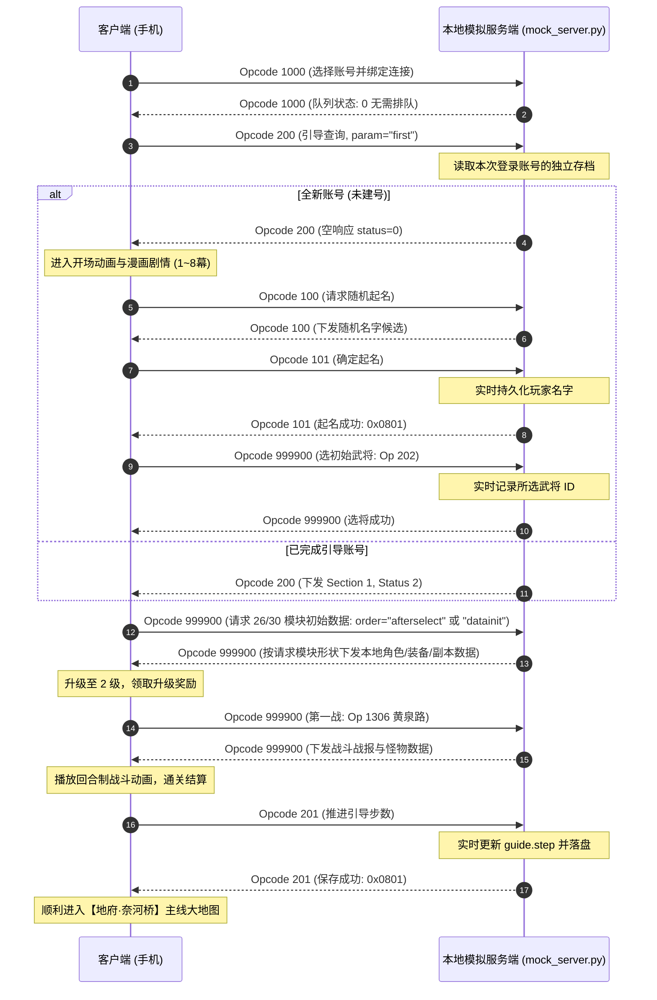

# 《作妖计》(ZuoYaoJi) 本地单机模拟服与逆向工程套件

本仓库提供《作妖计》(Cocos2d-x + Lua + Protobuf 架构) 手游的完整本地单机化运行环境、离线模拟服务端、逆向分析资源以及自动化重打包脚本。

---

## 🌟 核心特性

- **局域网直连，无需 ADB**: 安卓手机与电脑模拟器使用同一份 APK，直接连接电脑的固定局域网 IP 和统一端口 `14600`；不依赖 USB 调试或 `adb reverse`。
- **多账号独立存档**: 复用登录页选服界面选择“账号 1、账号 2 …”，每台设备记住自己的选择。一个服务端同时处理不同账号；同一个账号只允许一个在线连接，避免覆盖进度。这是独立存档多开，不提供账号间交易、组队等共享世界功能。
- **本机网页后台**: 查看账号在线状态、资源、阵容和副本进度；离线备份、恢复和重置存档；浏览配置并编辑已开放的道具与奖励项。
- **全流程新手引导支持**: 完整保留原汁原味的游戏体验，包括开场剧情漫画（1~8幕）、起名与随机名字生成、3选1初始武将、新手第一战（黄泉路对阵小野鬼回合制战斗）、升级结算与主线地府大地图。
- **自研战斗 v2**: 招募武将可自由上阵，实时挑战奈河桥、葬剑谷、轮回殿共 16 关，包含治疗、增减益、真实胜负、掉落与升级；采用的自研规则见 [battle_rules.md](battle_rules.md)。
- **本地模拟充值与封神招募**: 点击充值档位直接确认本地支付成功，按配置发元宝、VIP及首充/月卡权益；封神支持单抽、十连预览、重抽和确认领取，未领取结果重登保留。
- **渐进式角色持久化存档 (`role_save.json`)**:
  - 实时捕获并记录玩家自定义起名（Opcode 101）；
  - 实时记录玩家所选初始武将（Opcode 202）；
  - 实时记录新手引导与剧情步数（Opcode 201 `guide.step`）；
  - 支持中途退出后的**断点无缝续存**；
  - 账号 1 沿用 `role_save.json`，其他账号使用 `accounts/<编号>/role_save.json`；可按账号重置，引导与角色快照互不影响。
- **Comb Signature 复合路由**: 客户端 `Opcode 999900` (`CombMessages`) 按子消息 ID 集合与完整请求载荷匹配，兼容 Comb 封装、引导 `201` 及上阵 `1003` 的 Protobuf 字段顺序差异，区分主城 26/30 模块、功能列表和不同关卡；录制段之间隔离应答序号，避免混合采集后重复回包。
- **TCP 流重组还原 (TCP Stream Reassembly)**: 彻底修复抓包中超过单帧 MTU 限制的分包数据（4,101 字节全量主城包），根除 Protobuf 反序列化时触发的 `decoder:247 Truncated message` 致命错误。
- **全量离线配置内置**: 将从官方 CDN 提取的 1,244+ 个 JSON 数据表注入 APK assets 中，彻底解决离线时缺少 `guide_step.json` / `guide_section.json` 导致的黑屏崩溃。
- **自动化秒级打包流水线**: `build_local_apk.py` 使用 Python 原生 zip 操作与 `apksigner`，绕过容易出现资源解析崩溃的 Apktool 回编译，数秒内完成改包与 V1/V2 签名。

---

## 📂 项目结构全景

```text
zyj/
├── mock_server.py           # 启动入口、命令行、局域网 TCP 与账号绑定
├── zyj_server/              # 模拟服请求处理，不依赖启动入口
│   ├── protocol.py          # TCP 封包、Protobuf 与 Comb 编解码
│   ├── guide.py             # 引导配置、进度、迁移与消息
│   ├── accounts.py          # 账号占用、独立路径与离线维护锁
│   ├── configuration.py     # 配置校验、覆盖与服务端/APK 共用读取
│   ├── storage.py           # 原子文件写入与备份
│   ├── admin/               # HTTP 路由、存档视图与独立 HTML/CSS/JS
│   ├── activities.py        # 活动页面、首期珍品限购、消费奖励及提示
│   ├── battle.py            # 确定性自动战斗、目标/技能/状态、伤害与成长计算
│   ├── recruit.py           # 普通/封神招募、暂存预览、武将去重
│   ├── recharge.py          # 本地模拟订单、VIP及首充/月卡权益
│   ├── formation.py         # 换将/布阵、装备继承、缘分属性差量
│   ├── player.py            # 角色/主角状态、存档与整组回包准备
│   ├── replay.py            # 共享录制索引、每连接的匹配计数
│   └── session.py           # Session.handle() 请求处理入口
├── build_local_apk.py       # 自动化 APK 本地化注入、热更与打包签名脚本
├── recorded_frames.json     # 经过 TCP 流重组还原的 529 条真实业务协议帧库
├── test_activity_frames.json # 完成账号抓包的活动查询/奖励测试样本，不作为玩家初始状态
├── battle_rules.md          # 自研 v2 范围、公式、结算规则与试玩说明
├── role_save.json           # 账号 1 的原有存档，不自动搬迁
├── accounts/2/role_save.json# 账号 2 的独立存档 (其他账号同理，运行时生成)
├── config_overrides.json    # 网页保存的少量配置覆盖 (运行时生成，Git 忽略)
├── backups/                 # 账号及配置的历史备份 (运行时生成，Git 忽略)
├── test_mock_server.py      # 协议、玩法状态、账号隔离与双连接回归
├── test_build_local_apk.py  # 局域网配置和客户端补丁回归
├── test_admin.py            # 离线维护、配置一致性与 HTTP 回归
├── debug.keystore           # 统一签名密钥库
├── configs_sec5.zip         # 官方全量 1,244+ 个离线 JSON 配置文件
├── scripts_clean/           # 解密且纯净格式化的 1,300+ 个 Lua 脚本源码 (便于审计分析)
├── scripts_decrypted/       # 解密出的原版 Lua 脚本资产
├── zyj_tutorial_traffic.pcap# 抓取自官方新手教程的原始 TCP 通信流量
├── z7_7_4.apk               # 官方原始 APK
├── zyj_local.apk            # 注入离线配置与局域网直连的客户端
└── README.md                # 本说明文档
```

`Session.handle(opcode, seq, body)` 返回有序的完整协议帧，不持有 socket；录制回包统一经过 `player.prepare_recorded_responses()`，原子保存成功后才返回给 TCP 入口发送。请求处理抛错后入口关闭连接，不继续使用该会话。配置、录制和默认存档路径由根目录入口确定并显式传入，导入 module 不读取资源或启动 ADB/监听。

---

## 🛠️ 网络协议与封包规范

### 1. 基础包头结构 (16 字节)
通信基于 TCP 二进制协议，每个数据包均包含 16 字节固定大端包头：

| 偏移 | 字段名 | 类型 | 字节序 | 描述 |
| :--- | :--- | :--- | :--- | :--- |
| `0x00` | Magic | `uint32` | Big-Endian | 协议魔数，固定为 `0x0000EE1C` |
| `0x04` | Length | `uint32` | Big-Endian | 后续载荷 (Payload) 字节长度 |
| `0x08` | Opcode | `uint32` | Big-Endian | 协议操作码 (例如 `1000` 登录, `200` 引导) |
| `0x0C` | Seq | `uint32` | Big-Endian | 请求序号 (客户端发起递增，服务端原样应答) |

### 2. 核心协议交互流程


---

## 🚀 快速上手

### 1. 环境准备
- 操作系统: Linux / macOS / Windows (WSL)
- Python 3.8+
- 安卓手机或安卓模拟器，能访问服务端电脑所在的局域网；无需开启 USB 调试
- 仅重打包时需要：原版 `z7_7_4.apk`、Java Runtime 和 Android SDK build-tools (`zipalign`、`apksigner`)
- 建议在路由器为服务端电脑保留固定 IP；电脑防火墙只对可信局域网放行 TCP `14600`，不要设置公网端口转发

### 2. 构建一次局域网客户端

把原版 `z7_7_4.apk` 放在脚本旁，指定**服务端电脑**的局域网 IP。以下 `192.168.1.20` 仅为示例，不是手机或模拟器自己的 IP：

```bash
python3 build_local_apk.py --server-ip 192.168.1.20 --accounts 3
```

`--server-ip` 必填，只接受局域网 IPv4，拒绝回环地址和公网地址；`--accounts` 默认为 2，范围 1~1000。所有账号共用同一个 IP 和端口，不需要为不同账号分别打包。电脑 IP 或账号列表改变后，需要重新打包、更新客户端。

### 3. 启动统一服务端
```bash
# 监听 0.0.0.0:14600，不调用 ADB
python3 mock_server.py
```
保持服务端运行，再进入游戏。能播放本地开场剧情并不表示已连上游戏服务；服务未启动时，随机取名和建号请求无法正常完成。

在运行服务端的电脑上打开 **http://127.0.0.1:14601** 进入管理后台。后台与游戏共用一个进程和账号占用表，随服务端退出而关闭。端口冲突时可用 `--admin-port 14602`；指定 `0` 会自动分配端口，以启动日志中的地址为准。

> [!WARNING]
> 账号编号只是存档选择，**不是密码认证**。知道协议且能访问服务端的人可以选择任意账号；仅适用于自己的可信局域网。电脑关机、休眠或网络断开都会影响游玩。

### 4. 安装并选择账号

把同一份 `zyj_local.apk` 传到手机、导入模拟器安装，点击图标启动。登录页选服列表会显示“账号 1、账号 2 …”：手机可选账号 1，模拟器选账号 2，同时游玩互不影响。以后换设备时选择原账号即可续玩，需先退出原设备的同一账号。

ADB 可以仅用于可选的安装和日志调试，游戏连接不经过它：

```bash
adb install -r zyj_local.apk
adb shell monkey -p com.ldfs.zyjyg.local -c android.intent.category.LAUNCHER 1
```

若无法连接，检查 IP 是否正确、防火墙是否允许该端口、Wi-Fi 是否启用了访客隔离或客户端隔离。异常断网后旧会话需等待 TCP 断开才能释放；首版不自动踢旧会话接管。

### 5. 按账号重置

也可从命令行重置：先停止正在运行的服务端，再执行以下命令。操作前自动备份目标存档，重置后仍会启动统一服务端：

```bash
python3 mock_server.py --account 2 --reset
python3 mock_server.py --account 2 --reset-guide
```

两条命令分别表示清空账号 2 的全部进度、仅清空账号 2 的引导。未指定 `--account` 时仍以账号 1 为目标，不影响其他账号。所有存档相对脚本目录；在新 worktree 或复制工程中启动时，不会自动读取旧目录的存档，迁移前请停服并备份。

### 6. 网页账号维护与配置编辑

**账号档案**列出已存档、在线或有备份的账号，也可输入 1～1000 的编号打开。详情显示最近落盘的资源、武将与阵位、装备、背包、副本及活动/招募/充值状态；点击“刷新数据”更新。查询不会触发体力恢复或修改存档，因此在线数值以游戏最后一次成功保存为准。

退出目标账号的游戏连接后，可创建备份、重置引导、重置账号或选择备份恢复；其他账号可继续游玩。登录与维护共用锁，在线账号拒绝维护。操作核对存档版本，页面过期时刷新重试。重置和恢复会先把当前文件备份到 `backups/accounts/<编号>/<备份ID>.json`；备份失败则停止操作。恢复前通过游戏存档校验，保存失败保留原文件。重置后仍可从账号列表找到备份并恢复。“下载存档”只导出当前文件，也可用于保留损坏文件。

重置引导只清除引导历史，保留角色、背包与奖励领取记录，不会重新发奖；完整新号体验使用“重置账号”。

**游戏配置**支持按表、ID或文本浏览，当前只允许编辑：

| 表 | 条目 | 可编辑内容 |
| --- | --- | --- |
| `props` | 20014 / 20019 / 20015 / 20020 | 恢复量、道具说明 |
| `begin7day_task` | 80001 / 80030 | 首日奖励、名称 |
| `liveness` | 16（协议任务 116） | 强化次数门槛、奖励及说明 |

奖励格式为 `物品ID,数量;`，只接受已实现的银币、元宝、道具、碎片和装备；未知物品、重复条目及越界数量会被拒绝。保存只写 `config_overrides.json`，原 ZIP 保留，旧覆盖备份到 `backups/configs/`；“恢复原配置”移除该条目的覆盖。

配置修改对所有账号生效，已有领取记录不会清除。**保存后需停止并重启服务端，再重建、安装 APK**：服务端和打包器读取同一份覆盖，APK 的 `assets/config/1/` 与 `assets/config/5/` 同步更新。运行中的会话继续使用启动时配置；网页显示“等待服务端重启”直到当前覆盖被加载。恢复量或奖励改变时，也应修改对应说明文字。

后台固定绑定 `127.0.0.1`，校验 Host/Origin 和本次进程的写入令牌；使用浏览器直接打开日志中的本机地址。

---

## 🔨 重新构建本地化客户端 (`build_local_apk.py`)

将原版 APK 放到脚本旁并命名为 `z7_7_4.apk`，安装 Android SDK build-tools 并设置 `ANDROID_HOME`（或把 `zipalign`、`apksigner` 加入 PATH），即可构建 `zyj_local.apk`：

```bash
python3 build_local_apk.py --server-ip 192.168.1.20 --accounts 3
```

构建器从原 APK 解密脚本，在 `get_patched_lua_scripts()` 中执行带版本断言的替换；`scripts_clean/` 仅供分析，直接修改它不会打入 APK。工具查找兼容 Windows 的 `.exe/.bat` 和 macOS/Linux 的无后缀工具名。

该脚本将自动执行：
1. **注入离线全量 JSON 配置**: 读取 `configs_sec5.zip` 与 `config_overrides.json`（若存在），注入 APK 的 `assets/config/1/` 和 `assets/config/5/`，保留引导热区补丁；
2. **统一局域网入口**: 生成账号列表，全部连接指定电脑 IP 的 `14600` 端口，登录消息携带账号标识；账号编号不改变离线配置的 section；
3. **解除日志打印抑制**: 启用底层 `log.so` 日志透传，允许 Lua 输出和报错直达 `adb logcat`；
4. **V1 + V2 签名生成**: 使用 `debug.keystore` 自动签名，生成即装即用的 `zyj_local.apk`。

充值页补丁由 `patch_recharge_script()` 生成，使用普通 `CCScrollView` 承载八个档位，避开崩溃栈中的 `LuaEventHandler::tableCellAtIndex` 路径。`UIRecharge` 收到 `115` 订单后直接发送 `116` 确认，不调用支付SDK；无需支付凭证 `20000`。`window_recruit` 恢复封神令不足时的元宝显示及支付分支，连续单抽会刷新下次支付类型。这轮功能需要重新构建并安装 APK。

构建工具可从 `PATH` 或 `ANDROID_HOME/build-tools/<版本>/` 查找，支持原生 macOS/Linux 名称及 Windows 的 `.exe`/`.bat` 名称。

---

## 🔍 逆向关键避坑指南 (Troubleshooting)

1. **Protobuf 报错 `[Lua "decoder:247"] Truncated message`**
   - **原因**: 复合协议 `Opcode 999900` 长度达到 4,101 字节，抓包时跨越了 3 个 TCP 分段（MTU 1500 限制）。若未做 TCP 流重组直接保存，会导致数据包被腰斩。
   - **解决**: 使用 TCP 流重组算法（`mock_server.py` 已内置修复后的全量数据），保证 26 个子模块的反序列化完整性。

2. **启动卡在“加载配置文件”或闪退**
   - **原因**: 原版游戏依靠 CDN 动态热更拉取 `guide_step.json`、`guide_section.json` 等配置，单机环境访问外网 CDN 失败会导致配置为空指针崩溃。
   - **解决**: 已将官方 CDN 的全量 1,244 个 JSON 配置文件直接打包内置于 `zyj_local.apk` 的 assets 目录下。

3. **多次重连后界面功能错位**
   - **原因**: 简单回放服使用单纯计数器轮询 `resp_map`，一旦发生跳步或重连，序号错位会导致将“选将包”错回给“主城界面”。
   - **解决**: 组合请求按子模块 ID 集合与完整请求载荷匹配，区分同一协议下的不同关卡、招募和上阵参数，不再按连接序号选择组合响应。普通回放的序号命中和备用路由都核对 opcode 与完整载荷，计数按参数隔离，不能用其他参数的录制响应兜底。未录制参数不执行其他录制操作的推送、奖励或扣费；其中关卡挑战和周年兑换返回原生错误应答，其余未实现业务仍返回空包。

本地登录（1000）由 TCP 入口校验 `local_account_<编号>` 后绑定独立存档，不使用录制登录响应；这仍不提供密码鉴权，请仅用于可信网络。同参数对应的多份录制响应仍按连接内次数轮询，尚不等于完整业务实现。

实机首战曾因 Protobuf 字段顺序不同而返回空组合包：Comb 子消息的 `id/data`、引导 `201` 的 `section/step` 与抓包顺序相反，但值相同。录制索引和实时请求现在统一规范这些消息及上阵 `1003`（`GeneralChangePos`）的字段顺序，共用参数计数；子消息顺序、同字段重复值顺序、未知字段和重复字段均保留，其他子消息的 data 仍按完整字节匹配。新增回归覆盖实机原始首战请求、首战奖励与引导重连、上阵字段换序后的阵容持久化、全教程 Comb 字段换序，以及修改参数或添加字段不改存档。

混合录制按客户端请求序号回退（含重用相同序号）分段，同段内按序号与 opcode 匹配跨请求到达的应答，不跨段拼接。精确索引保留 `(seq, opcode, 完整载荷)` 对应的各份响应组，不让后来的采集覆盖旧记录；精确键有歧义时仍使用按参数隔离的连接内计数，不合并成多份应答。当前录制格式没有连接标签，独立采集若序号没有回退，需补充标签后再导入，不能靠此规则识别所有连接边界。

初始化同样要求完整录制参数匹配，不再对任意大型 Comb 套用通用模板。已匹配的 26/30 项初始化保留各自模块顺序；公共模块先取录制中一级新号的基础，再回填本地存档，只额外补齐新采集中的空扩展 `8101/8105/8109/8110`，不播放第二天完成账号的背包、主角或功能快照。缺少新号基础或发现尚未支持的非空扩展时，拒绝构建路由。新增第二天礼包采集不代表开放 `80002` 或日/周重置业务。

### 服务端回归验证

```bash
python3 -B -m unittest -v test_mock_server test_build_local_apk test_admin
python3 -m compileall -q -x "[.]_" mock_server.py zyj_server build_local_apk.py test_mock_server.py test_build_local_apk.py test_admin.py
```

多账号适配专项可运行：

```bash
python3 -B -m unittest -v test_mock_server.LanAccountTests test_mock_server.EntryPointTests test_build_local_apk test_admin
```


测试使用临时存档，不启动 ADB 或使用真实 `14600/14601` 端口；网络用例仅在回环地址临时端口验证双客户端和 HTTP。覆盖账号隔离、未登录访问拒绝、重复登录、重置范围、维护/登录互斥、备份与失败写入保护、跨站请求拒绝、配置版本冲突，以及 APK 两份配置与服务端的一致性。协议回归覆盖序号碰撞、战斗参数匹配、普通回放的参数乱序与计数隔离、未知进阶参数不扣费、TCP 分片、教程 167 个请求在组合序号改变后的回包对照和每个请求后重连的状态一致性。

教程对照夹具只取原 410 帧录制段，但服务端路由加载完整 529 帧混合库；新增回归覆盖段间序号重用、跨请求应答不越段、登录/配置仅一份应答、30 项初始化、新旧初始化恢复同一存档、未知初始化参数不改存档、采集顺序反转及录制源数据保持不变。

拆分回归还覆盖共享录制时的会话计数隔离、显式存档路径、整组状态先于首个推送落盘、保存失败不回成功、异地目录导入和 `--reset` / `--reset-guide` 启动行为。

新增活动回归使用 `zyj_official_guide_traffic.pcap` 中的 9 份真实查询/奖励回包，验证奖励格式、领取条件、防重复、重连状态、背包溢出和保存失败回滚；这些完成账号数据只作测试对照，不直接播给新号。

时间/体力回归固定测试时钟，覆盖实时校时格式、360 秒边界、离线恢复、余秒、上限、满体力不囤恢复次数、同连接消费后保留期限、时钟回拨和恢复/战斗整组保存失败；全部使用临时存档。

恢复道具回归还覆盖四种丹药的配置增量、批量数量、与新手礼包相同序号的路由、活动领奖后使用、后续教程录制不冲掉新余额、资源溢出、非法参数和扣道具/自然恢复整组保存失败；新生成的回包按 Lua 描述符和客户端消费逻辑验证，并非已有官方丹药回包的逐字节复现。
客户端补丁测试使用分析脚本夹具，不等同于原版 APK 重打包或真机验证。

活动红点回归覆盖全量/指定 ID 查询格式、重复 ID 的顺序、达标与领奖推送、同连接刷新不重复推送、重连初始化、保存失败不发包，以及保留无关提示和未知字段。教程对照仍核对原有 33 条状态推送，新增 `1034` 红点推送单独验证，不混入录制样本。

已恢复教程中 33 条非空阵容/战力推送（205、1024、1027），保留 `seq=0` 和抓包中的相对顺序；组合消息内的 201 在成功应答后与独立 201 共用进度保存逻辑，重连可查询最后上报步骤。格式错误的上报不会改写存档，旧格式存档仍会迁移。完成判定仍使用配置文件中的真实步数，不会强制跳过引导。

引导进度现在只前进、不倒退：迟到的旧步骤仍记入历史，但不会重开已完成段；已加载配置时，未知段或超出配置范围的上报会被拒绝。本地 Section 1 仍按 83 步完成，回归覆盖 81→82→83 及重连。完成账号抓包的 `status=2, step=81` 与本地配置的差异尚未查明；现有 Lua 显示 82/83 的展示点击也会上报 201，本地缺少 APK，不能据此把 81 步硬标为完成。

角色名字、已录制选将的选项 ID、主角成长及角色数值已接入持久化。升级、奖励、强化和主角进阶的收支由服务端读取录制响应与配置更新，不依赖客户端 `999898` 上报。重连初始化包直接包含当前角色数据，不再先发录制的新号数据再补推纠正；零余额和正常消费也会保留。

随机起名 `100` 使用 `configs_sec5.zip` 中的 `5/rollname.json`，独立抽取姓氏 `name1` 和形象对应的名字列 `name{形象ID+1}`，不再重复回放唯一的录制名字。只接受包含一个形象 ID（1～3）的完整 `Ids` 请求；返回 UTF-8 `StringContent`，不建号、不改名、不修改已有存档。正式起名仍由 `101` 保存，选将仍受已录制参数范围限制。

教程中已录制的武将、装备、上阵位置、道具、武将碎片和副本进度也已接入持久化。局部阵容更新按实体合并，不会清掉未更新的武将或装备；招募令、礼包和培养材料按实际操作增减，空背包重连不会重新生成礼包。关卡星级、下一地图解锁和宝箱领取状态可通过重连初始化包及独立查询恢复。

`999905` 现返回宿主机当前 Unix 秒数与抓包相同的 UTC+8 时区项（`-8`），不再回放历史时间；非空参数会被拒绝，未建号的纯时间查询不会创建进度存档。Role 的创建时间、登录时间和开服时间（字段 15/16/22）保持原值，不当作当前时钟覆盖。

体力现按抓包交叉验证的 **360 秒恢复 1 点**，在匹配请求的共享回包流程中结算，不运行后台计时线程：先恢复再扣战斗体力，正常消费保留剩余间隔，恢复到等级上限即停表，奖励造成的超上限余额不截断。Role 查询及主城初始化会回填当前体力和字段 17/18 的下次/全部恢复倒计时；`stamina_clock` 的下次恢复时间与已检查时间、业务结果一起原子保存后才发包。满体力不囤恢复次数，时钟回拨不重复补发或提前恢复。

旧存档缺少 `stamina_clock` 时，从升级后首次处理角色状态的时刻起算，不按抓包时间或角色创建时间追补；非法计时存档会被拒绝加载并保留原文件。离线恢复依赖宿主机时钟，请保持系统时间准确。精力恢复间隔尚无可靠配置或抓包依据，暂未实现；实时校时不会自动启用跨天/跨周活动重置。

背包的独立 `1201` 请求现支持体力丹 **20014/20019**（每个恢复 25/50 点体力）和精力丹 **20015/20020**（每个恢复 10/20 点精力）。请求为 `Ids [cid, count]`，数值读取 `props.param1`，每次 1～100 个与客户端批量窗口一致；必须已建号且拥有足量道具。先结算自然恢复，再整批扣道具、增加资源，允许超过等级恢复上限但拒绝 int32 溢出。道具数量、资源和体力时钟一起原子保存，失败不发成功包；客户端自己扣使用数量，因此回包的 `usedcidnums` 为空，避免扣两次。

本阶段道具使用只开放上述恢复丹，不开放挑战书、随机箱、自选箱或限时/VIP 礼包使用；新手礼包 20111 仍按已录制的完整参数匹配，未扩大任意组合请求的支持范围。精力丹使用与精力定时恢复是两回事，后者仍未实现。

首日开服活动已支持 `3610/3611` 的奖励 **80001**（建号后的每日礼包）和 **80030**（通关配置指定的 `42101/5`）；奖励内容读取 `begin7day_task`，装备分配大于 1000000 的本地 iid，不复用完成账号的装备实例。活跃度已支持 `2410/2411` 的强化任务 **116**：按成功强化后的实际等级增量推进，达到任务 16 的配置门槛后可领取，`6517` 返回领取所得的 5 点活跃度。领取、背包/货币变更及 `activity_state` 一起原子保存，独立查询和主城初始化中的 3610 会返回当前领取状态。

上述业务的红点现与领奖共用条件：**40** 表示强化日常任务可领，**82** 表示首日每日礼包可领，**84** 表示首关通关奖励可领。`1032` 全量查询（含主城初始化）仅重写本阶段管理的提示，其他录制提示保持不变；全量值为 `功能 ID×100＋状态`。指定 ID 查询完全位于 `40、82～109、542` 时，可按请求顺序实时返回状态（含重复 ID）；混入其他 ID 仍按完整参数匹配录制，未录制的混合参数不执行任何状态变更。

已有角色的成功业务使红点变化时，在原响应组末尾追加 `seq=0` 的 **1034**（`IdNums`）变化推送；领奖标记、背包和货币保存成功后才统一发送，失败不会清灯。建号后的首次亮灯由初始化查询提供，不额外插入选将响应。未支持的首日其他页、第二至七天及周宝箱提示（83、85～109、542）固定为 0；本阶段不会因此解锁这些业务，其他功能的提示仍可能是历史录制值。

七日任务目前覆盖上述两项首日奖励和一个强化任务；其他七日奖励、付费礼包及日/周宝箱保持未解锁，跨天、跨周重置和完整七日规则尚未实现。旧存档缺失的活动领取/强化历史不能推断，新增活动记录从未领取、强化 0 开始；不会凭旧账号抓包补出完成进度。

用户提供的约 41.4 KB 抓包是 `zyj_official_battle_20261028_2014.pcap`（42,076 字节）。新增活动支持：

- `5010` 神将降临、`5020` 拜关公、`5030` 珍品折扣、`5039` 消费有礼，以及 `4810/4813/4814` 空拍卖行和记录；补齐 `5015/5017/5022` 商店、排行榜子页的字段。查询只接受空参数，列表长度由对应配置生成，不继承官方账号的领取记录。空拍卖行关闭两秒自动刷新。
- `5031 [商品, 数量]`：首期 `treasure_discount_1` 的 13 项限购商品，按配置扣资源并发放道具/武将碎片；客户端自行扣款，因此响应只含奖励，避免双扣。限购次数保存于 `activity_state.discount_bought`。
- `5040 [奖励ID]`：首期 `consumegift_reward_1` 的 6 档消费奖励。成功的本地元宝扣款累积到 `gold_spent`，领取标记为 `consume_claimed`；旧消费历史不从余额或录制推断。失败操作、领奖和到账元宝不增加消费额。
- 活动天数与倒计时使用 Role 字段 22 的开服时间、UTC+8 自然日和 `activity_time` 首期配置。仅支持首期，结束后禁止购买/领奖；未实现后续轮换或跨期重置。尚未建立 Role 时使用本地创建时间展示查询页。
- 新交易在存档副本中准备，扣款、奖励、消费额和限购/领取标记整组保存后才发包；参数错误、余额不足、数量越界和重复领取返回原生错误，同连接可继续查询。保存失败关闭连接且保留旧文件。拍卖竞价、神将供奉、随机抽奖及对应兑换仍明确拒绝，未扣资源。

周年兑换页面的 `4600` 查询现按 `mid_autumn_exchange` 的最大商品 ID 返回完整的「已兑次数、状态」数组，当前 15 项共 30 个整数，修复 `GameFashion.lua` 对缺失次数做减法的异常。此阶段仅开放浏览，尚未实现的 `4601` 兑换会返回错误，不扣材料或元宝；展示次数为 0，接入兑换时仍须实现时装持有、次数持久化及奖励结算。

独立 `1306` 已接入自研 v2，支持招募所得的可战斗武将，按当前阵容和关卡配置实时计算奈河桥42102、葬剑谷42103、轮回殿42104的16关。在原有攻击、雷电合体、怒气、眩晕、中毒、吸血、警戒和有界反击之上，补充前排攻击、治疗、攻防/闪避增减、减怒与王母娘娘受击回血。30轮上限，真实胜负；胜利发经验/掉落、增加属性并推进关卡，失败扣体力但没有奖励，重复胜利保留最高星。详见 [自研规则与试玩入口](battle_rules.md)。

战报、奖励、成长、关卡与体力时钟在存档副本中产生，整组原子保存后才发包。1306之后发送205战力和1001绝对角色同步，避免客户端重复扣体力。同连接最近成功请求可去重，状态变化后拒绝旧回复；跨重连没有可靠业务请求ID，不保证跨重连恰好一次。每场seed与规则版本记录于战报，存档保留 `last_battle` 摘要。

星级宝箱 `1304 [地图,0/3/6]` 已支持黄泉路、奈河桥、葬剑谷、轮回殿：按 `map.star1–3/award1–3` 校验和生成 SomeThings，奖励与领取标记原子保存后返回客户端奖励弹窗所需内容。修复了未匹配1304回空包导致“箱子已开但没奖励”的问题；旧版空回包未写领取状态，重登后可重新领取。重复、未达标、非法或范围外请求返回原生错误；未匹配的宝箱Comb也明确拒绝。单独1303全三星奖励尚未实现。

普通招募 `1403 [卡池,方式]` 已支持完成教程后的三池单抽、十连，以及招募令百抽。卡池1消耗招募令20100，卡池2消耗元宝，卡池3消耗高级招募令20619；后两池免费单抽冷却为12/24小时。价格、限时折扣、基础池权重、首次单抽池和首次十连保底读取配置。重复武将按 `general_fragment.recruit` 转碎片，同批新武将只生成一个实例，IID从2000001起分配。`1402` 返回当前次数和剩余冷却；扣费、武将/碎片、次数与冷却原子保存，重登恢复。客户端自行扣款，成功包只含奖励，修复了空1403成功包导致的抽卡报错。

本地招募采用配置基础池与首次保底；`recruit_count` 累计消费换池规则尚未明确，未实现完整官服概率系统。旧存档仅从已确认教程步骤13/30迁移对应次数，缺失冷却从可用开始。旧1401仍未实现。同连接最近成功招募可去重，存档变化后拒绝旧回复，跨重连不保证恰好一次。

封神单抽使用 `1403 [4,1]`；十连依次为 `7111` 预览、可选 `7112` 重抽、`7113` 确认领取，`7110` 恢复预览。单抽优先扣1枚封神令20618，否则500元宝；十连优先10枚，否则5000元宝，不混扣。按基础池的碎片/数量/权重抽取；**自研十连规则**为每批一名完整武将加九份碎片，重抽同样保底。重抽价格按 `buycount_price.modify_price`，当前998元宝。费用先扣并持久化预览，领取前不发奖；领取时重复武将转碎片。尚有未领取预览时不能开始新封神招募。

本地模拟充值使用持久化 `115 → 116` 订单：同档未付订单可恢复，确认过的订单重发不再给奖励；新订单替代旧订单，过期确认明确拒绝。八个可见档位按 `recharge.gold` 和首次 `isdouble` 倍率到账，累计模拟金额更新VIP。`2098` 一次性首充奖励、`2091` 月卡/终身卡每日奖励、`2093` 月卡累计奖励均按配置发放并记录领取。月卡续购增加30个UTC+8自然日，终身卡只买一次；每日领奖按UTC+8换日，时钟回拨不重复领。旧存档无充值历史时从零开始，充值余额/权益/背包一起原子保存。其他充值活动及VIP礼包尚未接入。

完成教程后，独立 `1003` 可在角色等级已解锁的1–7号阵位换将/换位，`1009` 可拖动布阵；校验武将所有权、可战斗标记、阵位、重复IID和主角留阵。换将继承目标阵位装备；已有上阵武将互换及拖动布阵整套移动。按配置装备/缘分的前后差量调整当前汇总属性，保留既有培养差值；升级同步补缘分成长，往返换将不会累积或丢失属性。未知装备进阶加成仍明确拒绝，助阵位换将尚未实现。

不支持的独立挑战、未匹配的战斗Comb以及周年兑换返回同请求序号的 `999999`（`Ids [请求opcode,0]`）与 `1999,seq=0` 原因广播；清除loading且不写存档。教程Comb仍按原有流程。生产录制库只含 `42101/1–5`、`42102/1` 六场教程战斗；[首次抓包](official_battle_capture_20261028.md)及[后续13场分析](official_battle_capture_20261028_followup.md)只作研究/回归，不加入生产回放。

三场基础官方战报的逐击伤害、终局HP和经验仍通过对照；憾地19段逐段取整再合计。目标选择、统一概率、星级、失败成本及成长补全是明确的**自研规则**，不声称完全还原官服。新增回归验证确定性、战报重放、所有16关、真实胜败、状态、首次/重复奖励、升级、重连和保存失败。原客户端Lua转换器离线检查660份生成战报，转换后HP/AP/回合一致；新阵容手机验收见下文。

旧存档从未保存过的阵容、物品和关卡明细无法凭空找回：缺失的 `world_state` 缓存仅以录制的新号基础建立，并打印告警，不会冒充完整恢复。已有的空缓存会保留；升级前请备份 `role_save.json`，不要为补明细直接重置进度。

状态按整组回包准备，原子保存成功后才发送；保存失败、余额/道具不足或存档解析失败时不会返回操作成功或覆盖原进度。礼包/宝箱/活动重复领取、未满足条件的活动请求、重复录制招募和过期的选将/战斗/培养/进阶会被拒绝，避免旧回包覆盖新状态。当前支持已录制教程、上述首日活动及其红点、本地模拟充值、普通/封神招募、自由上阵、恢复丹与限定范围的自研战斗；范围外战斗、任意关卡宝箱/全三星奖励、自由强化、精力随时间恢复、其他功能的动态红点和异步推送仍需继续补齐。自由强化还需要核实武将属性和总战力计算，不能仅按费用表扣钱、改装备等级。关卡挑战次数仍无每日重置。

2026-10-28 本次手机复测已通过首战、招募与上阵，角色升至 6 级，并依次上报第 81、82、83 步后完成本地新手引导；没有为对齐旧抓包的第 81 步而跳过末尾显示步骤。此验证范围不代表上述未实现业务已开放。

同日后续复测确认周年兑换页面可打开、滚动；望乡台挑战及 `4601 [15,1]` 兑换会显示原生“无效请求”，页面可继续操作，具体未实现原因通过主城广播发送。拒绝前后及重登后的角色、背包、副本、活动和引导数据一致，体力和元宝未扣除。此实机结果只覆盖当时的异常处理。

2026-10-29 战斗及宝箱修复后的 **175 项回归**与语法检查通过，380份战报通过原客户端Lua转换终局对照；新增宝箱回归覆盖奖励入账、回复前保存、重连、防重领、参数校验、溢出及保存失败回滚，三张地图共9档奖励通过原Lua奖励列表到弹窗入口检查。用户试玩日志已完成42102/2–5；手机动画与修复后的宝箱弹窗仍需实际体验确认。新活动页面、购买/领奖尚未实机复测，官方抓包也尚无这些交易的成功样本；已按客户端解析/扣款代码及配置测试限购、奖励、失败回滚和重连。

同日普通招募与充值修复通过 **185 项回归**、语法检查、13份打包脚本的Lua5.1编译及充值列表节点/按钮检查；82种可抽武将的配置、碎片映射和APK动画资源均已核对。新APK经zipalign、签名验证并覆盖安装到手机。临时存档实机验证：免费单抽获得马面且不扣令；付费单抽扣1枚高级招募令、重复雷公转20碎片；高级十连显示10名武将并按八折扣8枚令；普通百抽弹出奖励列表、按八折扣80枚令。重登后武将、碎片、55枚普通令、11枚高级令及免费冷却一致。充值页可滚动，连续开关5次无崩溃；点击档位返回原生“无效请求”，具体未开放原因通过广播发送，未扣资源。验收日志未发现Lua异常或Fatal signal。已停止临时服，将手机切回更新后的14600正式存档，原角色Lv7、260元宝及背包/关卡进度保留。未验证其他机型或长时间反复操作。

### 2026-10-29 开放功能验收

本轮开放模拟充值、封神和自由上阵，替代上文早期版本的对应限制。**200项回归**、语法检查、15份打包Lua5.1编译及660份战报转换校验通过；新APK已签名验证并覆盖安装。手机热点ADB为 `192.168.43.1:5555`，验收使用独立14601服务和临时角色。

- 6元、25元月卡、648元档分别到账132、250、23340元宝，累计VIP依次为2、3、6；点击档位后直接本地确认，没有拉起支付渠道。首充刘备/银币/离魂刀领取成功；月卡每日奖励到账，重登仍显示「已领取」。
- 最后一枚封神令单抽后，结果页自动显示500元宝续抽，实际续抽扣500。十连预览扣5000但背包不变，重抽扣998；重启客户端和验收服务后保留同一批结果，确认领取才入背包并清除预览。
- 抽得的金翅大鹏换入电母阵位，继承该阵位装备；拖动到前排后关闭布阵窗口，`1009` 保存整套换位。王母、太乙真人分别在已有阵位和空阵位上阵；断线重登后阵容、装备、战力、充值权益、余额和关卡进度一致。
- 新阵容完成三生石 `42102/5` 两次、剑铺 `42103/1` 一次，均三星结算；手机完整播放新将和回血战报并显示经验/奖励。战前快照加原seed复算确认王母回血、太乙治疗与防御增益；主角/新将成长、体力消耗和首次/重复奖励已保存。
- 福利页预加载未实现的蟠桃查询 `2010` 曾因空成功包触发 `Layer_activity_peace:62` Lua错误；`2010/2011` 现返回原生未开放错误，防止解析缺失状态。修复后重新进入月卡页面通过，未再出现该异常。

验收后已停止14601临时服务，更新14600正式服务并恢复手机 `tcp:14600 → tcp:14600` 映射。正式角色「爱君远」重登核对为Lv7、260元宝、171000银币、体力62/62、战力6378；原阵容、背包、关卡及引导保持，验收奖励只存在临时存档。正式存档及旧APK已备份。未逐一实测全部武将动画、其他机型或长期运行；自由经验丹升级/强化、其他合体及高级培养仍不在本轮范围。

---

## ⚖️ 免责声明

本项目仅供网络协议逆向、游戏安全研究与个人技术交流使用。涉及的游戏素材、代码及商标版权归原游戏版权所有者所有。请勿用于任何商业用途或侵权行为。
