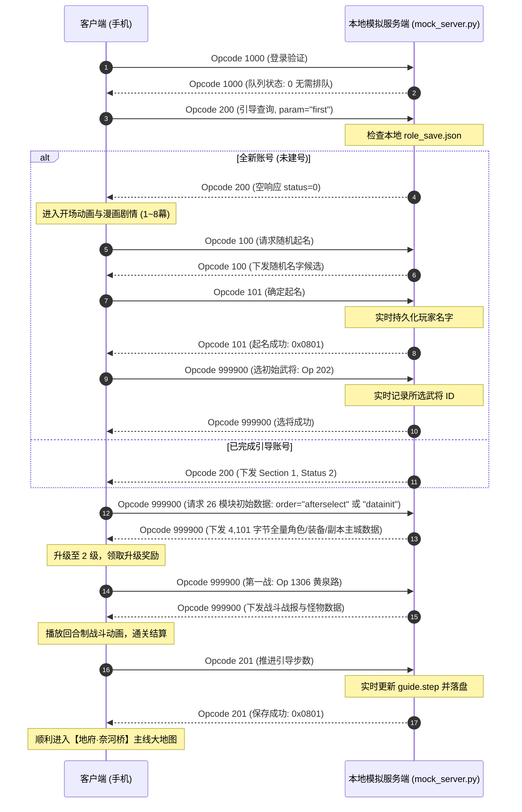

# 《作妖计》(ZuoYaoJi) 本地单机模拟服与逆向工程套件

本仓库提供《作妖计》(Cocos2d-x + Lua + Protobuf 架构) 手游的完整本地单机化运行环境、离线模拟服务端、逆向分析资源以及自动化重打包脚本。

---

## 🌟 核心特性

- **完整本地闭环**: 客户端通过 ADB 端口映射连接本地 Python 模拟服务端 (`127.0.0.1:14600`)，无需公网服务器即可独立单机游玩。
- **全流程新手引导支持**: 完整保留原汁原味的游戏体验，包括开场剧情漫画（1~8幕）、起名与随机名字生成、3选1初始武将、新手第一战（黄泉路对阵小野鬼回合制战斗）、升级结算与主线地府大地图。
- **渐进式角色持久化存档 (`role_save.json`)**:
  - 实时捕获并记录玩家自定义起名（Opcode 101）；
  - 实时记录玩家所选初始武将（Opcode 202）；
  - 实时记录新手引导与剧情步数（Opcode 201 `guide.step`）；
  - 支持中途退出后的**断点无缝续存**；
  - 提供一键重置存档功能 (`--reset`)，随时从头体验新号。
- **Comb Signature 智能复合路由**: 逆向破解客户端 `Opcode 999900` (`CombMessages`) 机制，基于子消息 ID 集合（如主城 26 模块、功能列表、关卡战斗）实现精准动态路由，彻底解决协议错位问题。
- **TCP 流重组还原 (TCP Stream Reassembly)**: 彻底修复抓包中超过单帧 MTU 限制的分包数据（4,101 字节全量主城包），根除 Protobuf 反序列化时触发的 `decoder:247 Truncated message` 致命错误。
- **全量离线配置内置**: 将从官方 CDN 提取的 1,244+ 个 JSON 数据表注入 APK assets 中，彻底解决离线时缺少 `guide_step.json` / `guide_section.json` 导致的黑屏崩溃。
- **自动化秒级打包流水线**: `build_local_apk.py` 使用 Python 原生 zip 操作与 `apksigner`，绕过容易出现资源解析崩溃的 Apktool 回编译，数秒内完成改包与 V1/V2 签名。

---

## 📂 项目结构全景

```text
zyj/
├── mock_server.py           # 启动入口、命令行、ADB 与 TCP 收发
├── zyj_server/              # 模拟服请求处理，不依赖启动入口
│   ├── protocol.py          # TCP 封包、Protobuf 与 Comb 编解码
│   ├── guide.py             # 引导配置、进度、迁移与消息
│   ├── player.py            # 角色/主角状态、存档与整组回包准备
│   ├── replay.py            # 共享录制索引、每连接的匹配计数
│   └── session.py           # Session.handle() 请求处理入口
├── build_local_apk.py       # 自动化 APK 本地化注入、热更与打包签名脚本
├── recorded_frames.json     # 经过 TCP 流重组还原的 410+ 条真实业务协议帧库
├── role_save.json           # 玩家角色持久化存档文件 (运行时自动生成/更新)
├── debug.keystore           # 统一签名密钥库
├── configs_sec5.zip         # 官方全量 1,244+ 个离线 JSON 配置文件
├── scripts_clean/           # 解密且纯净格式化的 1,300+ 个 Lua 脚本源码 (便于审计分析)
├── scripts_decrypted/       # 解密出的原版 Lua 脚本资产
├── zyj_tutorial_traffic.pcap# 抓取自官方新手教程的原始 TCP 通信流量
├── z7_7_4.apk               # 官方原始 APK
├── zyj_local.apk            # 注入本地配置与回环连接的本地化客户端
└── README.md                # 本说明文档
```

`Session.handle(opcode, seq, body)` 返回有序的完整协议帧，不持有 socket；录制回包统一经过 `player.prepare_recorded_responses()`，原子保存成功后才返回给 TCP 入口发送。请求处理抛错后入口关闭连接，不继续使用该会话。配置、录制和默认存档路径由根目录入口确定并显式传入，导入 module 不读取资源或启动 ADB/监听。

---

## 🛠️ 网络协议与封包规范

### 1. 基础包头结构 (16 字节)
通信基于 TCP 二进制协议，每个数据包均包含 16 字节固定大端包头：

| 偏移 | 字段名 | 类型 | 字节序 | 描述 |
| :--- | :--- | :--- | :--- | :--- |
| `0x00` | Magic | `uint32` | Big-Endian | 协议魔数，固定为 `0x0000EE1C` |
| `0x04` | Length | `uint32` | Big-Endian | 后续载荷 (Payload) 字节长度 |
| `0x08` | Opcode | `uint32` | Big-Endian | 协议操作码 (例如 `1000` 登录, `200` 引导) |
| `0x0C` | Seq | `uint32` | Big-Endian | 请求序号 (客户端发起递增，服务端原样应答) |

### 2. 核心协议交互流程


---

## 🚀 快速上手

### 1. 环境准备
- 操作系统: Linux / macOS / Windows (WSL)
- Python 3.8+
- Android SDK 调试桥 (`adb`)
- Java Runtime (`jarsigner` 或 `apksigner`)
- Android 真机（需开启 USB 调试模式）或 Android 模拟器

### 2. 启动本地模拟服务端
```bash
# 启动模拟服务端 (默认监听 14600 端口，并自动配置 adb reverse 端口映射)
python3 mock_server.py
```
> [!TIP]
> 如果想要清空已保存的进度、重新体验全新的建号流程，只需加上 `--reset` 参数：
> ```bash
> python3 mock_server.py --reset
> ```

### 3. 安装客户端并游玩
```bash
# 将修改后的本地化 APK 安装到手机
adb install -r zyj_local.apk

# 启动游戏主界面
adb shell monkey -p com.ldfs.zyjyg.local -c android.intent.category.LAUNCHER 1
```

---

## 🔨 重新构建本地化客户端 (`build_local_apk.py`)

如果您修改了 `scripts_clean/` 中的 Lua 脚本或者更换了配置，可以随时重新生成 `zyj_local.apk`：

```bash
python3 build_local_apk.py
```

该脚本将自动执行：
1. **注入离线全量 JSON 配置**: 解压 `configs_sec5.zip` 并注入 APK 的 `assets/config/1/` 和 `assets/config/5/`；
2. **本地回环网络定向**: 强制定向至 `127.0.0.1:14600`；
3. **解除日志打印抑制**: 启用底层 `log.so` 日志透传，允许 Lua 输出和报错直达 `adb logcat`；
4. **V1 + V2 签名生成**: 使用 `debug.keystore` 自动签名，生成即装即用的 `zyj_local.apk`。

---

## 🔍 逆向关键避坑指南 (Troubleshooting)

1. **Protobuf 报错 `[Lua "decoder:247"] Truncated message`**
   - **原因**: 复合协议 `Opcode 999900` 长度达到 4,101 字节，抓包时跨越了 3 个 TCP 分段（MTU 1500 限制）。若未做 TCP 流重组直接保存，会导致数据包被腰斩。
   - **解决**: 使用 TCP 流重组算法（`mock_server.py` 已内置修复后的全量数据），保证 26 个子模块的反序列化完整性。

2. **启动卡在“加载配置文件”或闪退**
   - **原因**: 原版游戏依靠 CDN 动态热更拉取 `guide_step.json`、`guide_section.json` 等配置，单机环境访问外网 CDN 失败会导致配置为空指针崩溃。
   - **解决**: 已将官方 CDN 的全量 1,244 个 JSON 配置文件直接打包内置于 `zyj_local.apk` 的 assets 目录下。

3. **多次重连后界面功能错位**
   - **原因**: 简单回放服使用单纯计数器轮询 `resp_map`，一旦发生跳步或重连，序号错位会导致将“选将包”错回给“主城界面”。
   - **解决**: 组合请求按子模块 ID 集合与完整请求载荷匹配，区分同一协议下的不同关卡、招募和上阵参数，不再按连接序号选择组合响应。普通回放的序号命中和备用路由都核对 opcode 与完整载荷，计数按参数隔离，不能用其他参数的录制响应兜底。未录制的普通/组合参数仅返回空包，不执行其他录制操作的推送、奖励或扣费。

本地登录（1000）是参数匹配的例外：沿用单存档模拟登录，允许客户端 UUID 与抓包不同，不提供账号鉴权，请仅用于可信网络。同参数对应的多份录制响应仍按连接内次数轮询，尚不等于完整业务实现。

### 服务端回归验证

```bash
python3 -B -m unittest -v test_mock_server
```

测试使用临时存档，不启动 ADB 或真实监听端口；覆盖序号碰撞、战斗参数匹配、普通回放的参数乱序与计数隔离、未知进阶参数不扣费、本地登录 UUID 兼容、TCP 分片、教程 167 个请求在组合序号改变后的回包对照，以及每个请求后重连并重新加载主城的状态一致性。

拆分回归还覆盖共享录制时的会话计数隔离、显式存档路径、整组状态先于首个推送落盘、保存失败不回成功、异地目录导入和 `--reset` / `--reset-guide` 启动行为。

已恢复教程中 33 条非空阵容/战力推送（205、1024、1027），保留 `seq=0` 和抓包中的相对顺序；组合消息内的 201 在成功应答后与独立 201 共用进度保存逻辑，重连可查询最后上报步骤。格式错误的上报不会改写存档，旧格式存档仍会迁移。完成判定仍使用配置文件中的真实步数，不会强制跳过引导。

角色名字、已录制选将的选项 ID、主角成长及角色数值已接入持久化。升级、奖励、强化和主角进阶的收支由服务端读取录制响应与配置更新，不依赖客户端 `999898` 上报。重连初始化包直接包含当前角色数据，不再先发录制的新号数据再补推纠正；零余额和正常消费也会保留。

教程中已录制的武将、装备、上阵位置、道具、武将碎片和副本进度也已接入持久化。局部阵容更新按实体合并，不会清掉未更新的武将或装备；招募令、礼包和培养材料按实际操作增减，空背包重连不会重新生成礼包。关卡星级、下一地图解锁和宝箱领取状态可通过重连初始化包及独立查询恢复。

旧存档从未保存过的阵容、物品和关卡明细无法凭空找回：缺失的 `world_state` 缓存仅以录制的新号基础建立，并打印告警，不会冒充完整恢复。已有的空缓存会保留；升级前请备份 `role_save.json`，不要为补明细直接重置进度。

状态按整组回包准备，原子保存成功后才发送；保存失败、余额/道具不足或存档解析失败时不会返回操作成功或覆盖原进度。礼包/宝箱重复领取、重复录制招募和过期的选将/战斗/培养/进阶会被拒绝并断开本次连接，避免旧回包覆盖新状态。通过测试不代表客户端引导已实机跑通；当前仍仅支持已录制教程路径，未录制选将与业务、后续招募、任意重复战斗、自由上阵/强化、体力随时间恢复和其他异步推送仍需继续补齐。

---

## ⚖️ 免责声明

本项目仅供网络协议逆向、游戏安全研究与个人技术交流使用。涉及的游戏素材、代码及商标版权归原游戏版权所有者所有。请勿用于任何商业用途或侵权行为。
